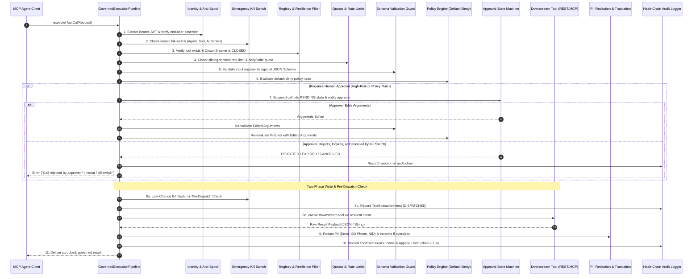

# Milestone M00 Plan: Baseline Architecture, Scope & Technical Feasibility (Revision 1)

**Status:** REVISED DRAFT (Addressing Architecture Reviewer Revision 1 Feedback)  
**Milestone:** M00  
**Project:** CSE 444 Project 1 — AgentGate (Governance Gateway for AI Agents' Tool Calls)  
**Author:** Student Implementation Team  
**Reviewer:** External Architecture Reviewer (ChatGPT)  
**Date:** 2026-11-15  
**Primary Coverage:** C1, C7, C8, C11 (Foundational architectural planning for FR1–FR10, QA1–QA5, C1–C12)  

---

## 1. Executive Summary & Gated Operating Mode Declaration

This document constitutes the revised architecture baseline and technical feasibility plan for **Project AgentGate**, incorporating all mandatory corrections requested in **Revision 1** of the external architecture review.

In strict compliance with `AGENTS.md` and project governance:
- **This milestone is strictly PLAN ONLY.**
- **No application code, `pom.xml`, Docker Compose configurations, or production secrets have been created or modified.**
- **No requirement is claimed as implemented, runnable, or verified.**
- **Implementation (Milestone M01) will NOT begin until this revised plan receives an explicit `APPROVED` verdict from the external architecture reviewer (ChatGPT).**

---

## 2. Corrected Technology Baseline & Dependency Matrix

The technology stack is strictly aligned with the course mandate requiring **Java 21** and **Spring Boot 4.x**. All previous references to Spring Boot 3.x and milestone releases have been eliminated as proposed implementation alternatives.

| Component / Layer | Selected Stable Baseline Version | Upstream Compatibility & Integration Role | Verification Spike / Task (M01) |
|---|---|---|---|
| **Java JDK** | **Java 21 LTS** (Eclipse Adoptium Temurin) | Language runtime; Project Loom virtual threads, pattern matching, records. | Pre-flight environment check (`java -version`). |
| **Spring Boot** | **4.0.9** | Core application framework, auto-configuration, dependency management. | Spike 1: Dependency resolution and clean context load. |
| **Spring AI** | **2.0.2** | Native Model Context Protocol (MCP) server & client starters (`spring-ai-mcp-*`). | Spike 1 & 2: MCP protocol negotiation and transport test. |
| **springdoc-openapi** | **3.0.x** (compatible with Boot 4.0.x) | OpenAPI 3.0 specification auto-generation and Swagger UI. | Spike 1: Verify springdoc 3.0.x auto-configuration with Boot 4. |
| **Spring Security** | Managed by Spring Boot 4 (Spring Security 7.x) | OAuth2 Resource Server, JWT token validation, method security, CSRF. | Spike 2: Keycloak client credentials JWT validation slice. |
| **PostgreSQL** | **16-alpine** | Relational data store for tools, policies, approval states, and hash-chained audit log. | Docker Compose health check & Flyway baseline migration. |
| **Flyway** | Managed by Spring Boot 4 (Flyway 10.x+) | Automated, repeatable database schema migrations (`V1__initial_schema.sql`). | M01 database migration initialization test. |
| **Redis** | **7-alpine** | Sub-millisecond atomic sliding-window rate counters, quotas, and instant kill switches. | Spike 3: Redis Lua script atomic increment benchmark. |
| **Keycloak** | **26.x** | Standards-compliant OAuth2 / OIDC Identity Provider (dev mode). | M01 Docker Compose realm import (`agentgate-realm.json`). |
| **Resilience4j** | **2.2.0** (or Boot 4 compatible starter) | Downstream circuit breakers, rate limiters, retries, time limiters. | M08 integration (configured in M01 base). |
| **ArchUnit** | **1.3.0** | Static architecture testing enforcing modular monolith boundaries (C6). | M01 automated architecture test. |
| **k6** | **0.50+** | Reproducible load testing and latency benchmarking (QA2). | Verified via `scripts/benchmark-latency.js`. |

> [!NOTE]
> **Compilation & Compatibility Assertion Policy:** In accordance with reviewer instructions, compatibility between Spring Boot 4.0.9, Spring AI 2.0.2, and springdoc-openapi 3.0.x is proposed based on upstream specifications. We explicitly **do not** claim these dependencies compile until an actual Maven build succeeds during M01. Resolving any dependency convergence issues is an explicit M01 verification task.

---

## 3. Environment Inventory & Prerequisites

A non-destructive, read-only inspection of the local workstation (`E:\Codes\Software-Architecture-Project`) was performed:

| Prerequisite | Detected State | Impact on M00 | Resolution for Milestone M01 |
|---|---|---|---|
| **OS & Shell** | Windows 10/11, PowerShell 7.5.4 | Compatible | All commands documented with native PowerShell and Bash parity. |
| **Git** | `2.55.0.windows.3` | Ready | Initialized; baseline governance and M00 plan committed incrementally. |
| **Java JDK** | *Not detected on PATH* | Non-blocking for M00 | Student must run `winget install EclipseAdoptium.Temurin.21.JDK` before M01 code generation. *(Unverified locally until installed)*. |
| **Maven** | *Not detected globally on PATH* | Non-blocking for M00 | M01 will bundle the official Maven Wrapper (`mvnw` / `mvnw.cmd`), making a global Maven install optional. |
| **Docker / Compose** | *Not detected on PATH* | Non-blocking for M00 | Student must install Docker Desktop (`winget install Docker.DockerDesktop`) or configure WSL2 Docker engine before M01 runtime tests. |
| **Host Memory** | 16GB physical RAM | Ready | Comfortably satisfies the 8GB laptop constraint (C1). Compose stack memory target is capped to $\le 2.5\text{ GB}$. |

---

## 4. MCP Architecture & Protocol Compatibility

### 4.1 Spring AI MCP Starters & Transport
- **Preferred Starters:** The gateway utilizes official Spring AI starters:
  - `org.springframework.ai:spring-ai-mcp-server-spring-boot-starter:2.0.2`
  - `org.springframework.ai:spring-ai-mcp-client-spring-boot-starter:2.0.2`
- **Transport Mechanism:** Streamable HTTP (JSON-RPC 2.0 over HTTP POST / Server-Sent Events SSE) at `/mcp/message`. Streamable HTTP supersedes legacy STDIO and raw SSE, providing full compatibility with remote AI agents.
- **Protocol Specification Version:** MCP Specification version **`2024-11-05`** (the standard baseline in Spring AI 2.0.2).
- **July 28, 2026 Specification Changes:** We acknowledge the prospective July 28, 2026 MCP specification changes (e.g. advanced bidirectional streaming extensions, standardized structured error schema updates). However, in accordance with reviewer guidance, **we do not claim support for the July 2026 version without empirical evidence**. Our baseline adheres strictly to verified `2024-11-05` semantics, with protocol version negotiation designed to accommodate updates.

### 4.2 Dynamic Per-Identity Tool Discovery & Execution Security
The official Spring AI MCP server starter auto-discovers and registers `@McpTool` beans globally. To enforce FR1 and FR2, the gateway wraps tool discovery and execution with a custom security interceptor:
1. **Dynamic Catalog Filtering (`tools/list`):** When an agent sends a JSON-RPC `tools/list` request, the request passes through Spring Security. The authenticated `AgentIdentity` is extracted from the OAuth2 token. The gateway queries `ToolRegistryService.findPermittedTools(agentIdentity)` and projects a customized tool list containing **only** tools the agent is authorized to call.
2. **Authorized Invocation (`tools/call`):** Any `tools/call` request must specify a tool permitted for the caller. If an agent attempts to invoke a tool outside its clearance, the gateway rejects the call before dispatching to downstream tools.
3. **No Premature Custom Transport:** We do **not** commit to building a custom JSON-RPC transport. If M01 Spike 1 reveals that Spring AI 2.0.2's starter internals strictly prevent dynamic per-request `tools/list` projection, we will document the exact technical incompatibility in `docs/milestones/M01/PLAN.md` and obtain reviewer approval before introducing any custom transport controller.

### 4.3 Minimal MCP Compatibility Test (M01 Acceptance Test)
An independent, scripted MCP client (`scripts/mcp-client-test.py` or `.ps1`) will be executed against the running gateway in M01 to demonstrate:
1. **Authenticated Connectivity:** Client connects over Streamable HTTP with an OAuth2 Bearer token; unauthenticated requests receive HTTP 401.
2. **Dynamic Tool Discovery:** Agent A (Finance clearance) lists tools and sees `[lookup_order, issue_refund]`; Agent B (Support clearance) lists tools and sees `[lookup_order]` only.
3. **Authorized Tool Execution:** Agent A successfully executes `lookup_order` via `tools/call` and receives structured JSON-RPC result.
4. **Rejection of Unauthorized Direct Invocation:** Agent B attempts `tools/call` on `issue_refund`; gateway rejects with JSON-RPC error `-32601` (Method Not Found) or `-32001` (Access Denied).
5. **Authentication Failure Handling:** Calling with an expired or forged JWT fails at the Spring Security filter with HTTP 401 before any MCP processing.
6. **Real MCP Protocol Message Compatibility:** Verified compliance with JSON-RPC 2.0 envelopes (`jsonrpc: "2.0"`, `id`, `method`, `params`, `result`, `error`).

---

## 5. Unified Governed Execution Pipeline Specification

Every tool invocation—originating from MCP `tools/call` or a REST gateway proxy—traverses this single, non-bypassable 11-step pipeline.



---

## 6. Policy-Store Failure & Audit Durability (QA4 & FR7 Resolution)

A fundamental tension exists between **QA4** (low-risk tools continue working during policy-store failure for up to 5 minutes) and **FR7** (every tool call must be recorded in a tamper-evident audit chain) when PostgreSQL is the storage engine for both.

### 6.1 Low-Risk Policy Caching & Outage Enforcement (QA4)
1. **In-Memory Policy Cache:** Policies are loaded into an in-memory Caffeine cache on startup and updated via scheduled poll / push event ($\le 10\text{ s}$).
2. **Outage Detection:** PostgreSQL connectivity is monitored via a dedicated health probe / circuit breaker. On the first JDBC connection failure, the `PolicyEngine` enters `DEGRADED_OUTAGE` mode.
3. **Monotonic Outage Clock:** The gateway records `outageStartNano = System.nanoTime()`.
4. **Strict 5-Minute Enforcement:** For every low-risk tool call during an outage, elapsed time is calculated:
   $$\Delta t = \frac{\text{System.nanoTime}() - \text{outageStartNano}}{10^9}$$
   - If $\Delta t \le 300\text{ seconds}$ (5 minutes): The call is evaluated against the last-known cached policy set.
   - If $\Delta t > 300\text{ seconds}$: Low-risk tools immediately **fail closed**, returning RFC 9457 `503 Service Unavailable` with detail `"Policy cache expired (>5m); gateway fail-closed."`

### 6.2 Fail-Closed Rationale for Medium- and High-Risk Tools
Medium- and high-risk tools (e.g. financial refunds, customer PII modifications, write operations) carry catastrophic operational and security risk. In the absence of an authoritative, live policy store, revocations or emergency rule updates cannot be guaranteed. Therefore, **medium- and high-risk tools fail closed immediately at $t = 0$ of a PostgreSQL outage**, returning HTTP 503.

### 6.3 Audit Durability During Outages (Local WAL Buffer)
During a PostgreSQL outage, the gateway **cannot** write synchronously to PostgreSQL. To satisfy FR7 without losing audit durability:
1. **Local Durable Write-Ahead Log (WAL):** When PostgreSQL is offline, audit records are written to a local append-only WAL file (`var/audit-fallback/audit-deferred.wal`) with synchronous disk flushing (`fsync`).
2. **Deferred Record Structure:**
   $$\text{DeferredRecord} = \{ \text{seqId}, \text{timestamp}, \text{agentId}, \text{userId}, \text{toolId}, \text{canonicalJson(redactedArgs)}, \text{outcome}, H_{local\_n} \}$$
   Each entry is linked via a local SHA-256 chain: $H_{local\_n} = \text{SHA-256}(H_{local\_n-1} \parallel \text{payload})$.
3. **What Happens if the Fallback Audit Mechanism Fails? (e.g. disk full):**
   - **FAIL CLOSED.** If an audit record cannot be durably written to either PostgreSQL or the local WAL buffer, **the tool call must not execute**. Auditability is a non-negotiable security requirement. The pipeline aborts with HTTP 500/503 (`"Audit durability failure: execution aborted."`).

### 6.4 Audit Reconciliation & Hash-Chain Integrity
When PostgreSQL reconnects:
1. A background `AuditReconciliationWorker` acquires an exclusive database lock on the audit chain head (`SELECT FOR UPDATE`).
2. The worker reads `audit-deferred.wal` sequentially from the beginning of the outage.
3. For each deferred record, the worker calculates the global hash based on the current chain head:
   $$H_{db\_new} = \text{SHA-256}(H_{db\_prev} \parallel \text{deferredPayload})$$
4. The record is inserted into `audit_log` with `reconciled_from_outage = true`, original invocation timestamp, and the continuous global hash.
5. The transaction commits, the WAL segment is marked processed, and the chain remains continuous, tamper-evident, and verifiable by `verify-audit` without fork corruption.

### 6.5 Irreversibility of External Writes, Two-Phase Recording & Idempotency
- **Physical Reality:** Once an external HTTP REST or MCP write call executes against downstream `demo-tools` (e.g. issuing a refund), that operation cannot be rolled back by rolling back a database transaction inside the gateway.
- **Two-Phase Recording:**
  - **Phase 1 (Pre-Invocation):** Record `ToolExecutionIntent` with status `DISPATCHED`, `idempotency_key`, timestamp, and sanitized arguments.
  - **Phase 2 (Post-Invocation):** Record `ToolExecutionOutcome` with status `COMPLETED` (or `FAILED`), downstream response code, latency, and redacted result.
- **Idempotency Guarantee:**
  - Every write tool call requires an `Idempotency-Key` header (or one is derived from `agentId + toolId + SHA-256(arguments)`).
  - If a client retries a call that is already `DISPATCHED`: The gateway returns HTTP 409 Conflict (`"Request currently in flight"`).
  - If a client retries a call that is `COMPLETED`: The gateway returns the cached outcome from the audit log without re-invoking the downstream tool.

---

## 7. Redis & Kill-Switch Failure Behavior

### 7.1 Separate Behavioral Modes
1. **Normal Redis Operation:** Redis 7 manages atomic sliding-window rate counters (via Lua scripts), daily quotas, hourly blast-radius write caps, and distributed emergency kill-switch flags.
2. **Development-Only In-Memory Profile:** An in-memory Caffeine rate limiter and local atomic boolean map are gated strictly behind `@Profile("dev")` or `@Profile("test")`. A startup validation check ensures that if `spring.profiles.active` contains `prod`, Redis **must** be reachable; the application will refuse to start if Redis is absent in production.
3. **Redis Failure During Normal (Production) Operation:**
   - **Write Tools & High-Risk Tools:** **Fail closed immediately (HTTP 503).** If Redis is unreachable, the system cannot verify rate limits, hourly write caps, or emergency kill switches. Allowing writes without quota verification violates security guarantees.
   - **Low-Risk Read Tools:** Fall back to a strict local in-memory circuit-breaker rate limit (e.g. max 5 reads/sec per instance) for up to 2 minutes, after which all calls fail closed if Redis does not recover.

### 7.2 Kill-Switch Activation & In-Flight Invalidation
1. **Kill Switch while Approvals are Pending:**
   - When an administrator activates a kill switch (disabling an agent, a tool, or all write tools):
     - The flag is atomically written to Redis and PostgreSQL.
     - The `ApprovalStateMachine` immediately queries active kill switches and transitions all matching pending approvals to `CANCELLED` with reason `"Cancelled by administrator kill switch"`.
     - Approvers and clients are notified immediately; pending requests cannot be approved.
2. **Kill Switch Immediately Before Downstream Dispatch (Last-Chance Pre-Dispatch Check):**
   - Even if a call was previously approved or verified, Step 8a of the pipeline executes a synchronous, non-cached assertion:
     ```java
     killSwitchManager.assertNotKilled(agentId, toolId, isWrite);
     ```
   - If the tool or agent was disabled milliseconds prior to dispatch, execution is aborted, state is recorded as `ABORTED_BY_KILL_SWITCH`, and an audit record is created.

### 7.3 Redis Persistence & Cold Recovery Strategy
- In `compose.yaml`, Redis is configured with an Append-Only File (AOF):
  ```yaml
  command: ["redis-server", "--appendonly", "yes", "--appendfsync", "everysec"]
  ```
- On gateway startup or Redis reconnection, `KillSwitchManager` re-synchronizes the Redis state from the authoritative PostgreSQL `kill_switch_state` table, ensuring complete recovery after a cold reboot.

---

## 8. Strengthened Approval Execution Semantics

### 8.1 Formal State Machine & Transitions
High-risk tool invocations pause as approvals managed by a formal state machine (`ApprovalStateMachine`):

```text
       [ Tool Call Initiated ]
                  │
                  ▼
              ( PENDING )
              │   │   │  └────────────────────────────────┐
      Approve │   │   │ Reject / Timeout / Kill Switch   │ Approver Edits Args
              │   │   │                                   ▼
              │   │   │                              ( EDITED )
              │   │   │                                   │
              │   │   │                     Schema & Policy Re-check
              │   │   │                                   ├──────────────┐
              │   │   │                            Valid  │              │ Invalid
              │   │   │                                   ▼              ▼
              │   │   │                       ( APPROVED_WITH_EDITS ) ( REJECTED )
              │   │   ▼                                   │
              │   └─► ( REJECTED / EXPIRED / CANCELLED )  │
              ▼                                           │
         ( APPROVED ) ◄───────────────────────────────────┘
              │
    [ Pre-Dispatch Assertion ]
              ├──────────────────────────────┐
       Passed │                       Failed │ (Kill switch / breaker open)
              ▼                              ▼
    [ Downstream Invocation ]         ( CANCELLED_PRE_DISPATCH )
```

- **States:** `PENDING`, `APPROVED`, `APPROVED_WITH_EDITS`, `REJECTED`, `EXPIRED`, `CANCELLED`, `EDITED`.
- **Transitions:**
  - $\text{PENDING} \xrightarrow{\text{approver approves}} \text{APPROVED}$
  - $\text{PENDING} \xrightarrow{\text{approver rejects}} \text{REJECTED}$
  - $\text{PENDING} \xrightarrow{\text{timeout elapsed}} \text{EXPIRED}$
  - $\text{PENDING} \xrightarrow{\text{kill switch activated / client disconnect}} \text{CANCELLED}$
  - $\text{PENDING} \xrightarrow{\text{approver edits args}} \text{EDITED}$

### 8.2 Revalidation of Edited Arguments
If an approver modifies arguments:
1. The new arguments **must** be re-validated by `SchemaValidator` against the tool's JSON Schema.
2. The new arguments **must** be re-evaluated by `PolicyEngine`. If the edited argument violates policy (e.g. refund amount edited to 2,500 BDT, exceeding the 2,000 BDT cap), the edit is rejected and the approver is notified.
3. Only if both checks pass does the state transition to `APPROVED_WITH_EDITS`.

### 8.3 Configurable Timeout Behavior
- Configured globally via `agentgate.approval.default-timeout: PT3M` (3 minutes) and overridable per-tool in the registry (`approval_timeout_seconds`).
- A scheduled timer monitors pending approvals. When the timeout expires, an atomic conditional update transitions the state:
  ```sql
  UPDATE approvals SET status = 'EXPIRED' WHERE id = :id AND status = 'PENDING';
  ```
- If the transition succeeds, the waiting thread is unblocked and returns an expiration error.

### 8.4 MCP Client Response Semantics
- **After Approval:** Client receives standard JSON-RPC 2.0 response with tool `result`.
- **After Rejection / Expiration / Cancellation:** Client receives standard JSON-RPC 2.0 error:
  - Rejection: `{ "code": -32000, "message": "Approval rejected by human approver: [reason]" }`
  - Expired: `{ "code": -32001, "message": "Approval request timed out after [X] seconds." }`
  - Cancelled: `{ "code": -32002, "message": "Approval cancelled: target tool or agent disabled by kill switch." }`
- **Client Disconnection:** If the client drops the HTTP connection while pending, the virtual thread marks the approval `DISCONNECTED_PENDING_OUTCOME`. The approval remains actionable by the human; if approved, the outcome is stored under the `idempotency_key` so a reconnecting client receives the result without duplicate execution.

### 8.5 Pre-Dispatch Re-verification
An approved request **never** executes blindly. Step 8a of the pipeline re-checks:
1. Active kill switch status (Agent, Tool, All Writes).
2. Downstream tool health and circuit breaker status.
3. Active rate limits and quotas.
If any check fails, dispatch is aborted, the approval is marked `REVOKED_PRE_DISPATCH`, and the event is audited.

---

## 9. Identity & Authorization Model

### 9.1 Machine Identity vs Trusted End-User Context
- **Registered Agent Identity:** Authenticated via OAuth2 Client Credentials (`client_id`, Bearer JWT issued by Keycloak).
- **Anti-Spoofing Rule:** Unverified HTTP headers (e.g. `X-User-Id: customer-123`) are strictly rejected.
- **Trusted End-User Context Implementation:**
  - Selected Mechanism: **Signed End-User Assertion Token (RFC 7519 JWT)** passed in the `X-User-Assertion` header.
  - The assertion token is signed by Keycloak (or a trusted enterprise IdP) and carries user identity claims (`sub: "<userId>"`, `aud: "agentgate"`, `exp`).
  - The gateway validates the assertion signature against Keycloak's public keys (`/certs` JWKS endpoint).
  - The calling agent's client credentials token must carry the OAuth2 scope `delegation:act_as_user`.
  - If the scope is absent, or the assertion signature/expiration is invalid, the request is rejected immediately with HTTP 401.

### 9.2 Keycloak Web Roles & RBAC for Web Interface
The administrative and approval web interfaces use Spring Security OAuth2 Login (OIDC Authorization Code Flow with PKCE) backed by Keycloak.

| Role Name | Granted Permissions & Accessible Endpoints |
|---|---|
| **`ROLE_ADMIN`** | Tool registration, OpenAPI import, policy editing/publishing, emergency kill switch activation (`/admin/**`). |
| **`ROLE_APPROVER`** | Viewing pending approvals, approving/rejecting/editing pending tool calls (`/approvals/**`). |

### 9.3 Comprehensive Endpoint Authorization & CSRF Protection
```java
http
    .authorizeHttpRequests(auth -> auth
        // Public endpoints
        .requestMatchers("/actuator/health", "/actuator/info", "/error", "/swagger-ui/**", "/v3/api-docs/**").permitAll()
        // Machine-to-machine MCP endpoint (Bearer token)
        .requestMatchers("/mcp/**").hasAuthority("SCOPE_agent:invoke")
        // Admin web portal
        .requestMatchers("/admin/**").hasRole("ADMIN")
        // Approval web portal
        .requestMatchers("/approvals/**").hasAnyRole("APPROVER", "ADMIN")
        // Deny all other routes
        .anyRequest().denyAll()
    )
    .csrf(csrf -> csrf
        // Enable CSRF on browser-based form endpoints (Thymeleaf with CookieCsrfTokenRepository)
        .ignoringRequestMatchers("/mcp/**", "/api/**") // Stateless Bearer token APIs are exempt from CSRF
    );
```

---

## 10. Quality-Attribute Validation Methodology

### 10.1 QA1: Security Red-Team Test Suite (30 Malicious + 200 Legitimate)
Automated test suite (`scripts/redteam.ps1` / `.sh`) executing exact vectors:
- **30 Scripted Malicious Requests (100% must be blocked or held):**
  - **Vectors 1–10 (Argument Smuggling & Injection):** SQL injection in parameters (`' OR '1'='1`), JSON smuggling, prompt injection payloads attempting to alter tool behavior.
  - **Vectors 11–20 (Cross-Customer Data Access):** Agent authenticated for Customer A attempting to read orders/records belonging to Customer B; calls with forged/untrusted `X-User-Id` headers.
  - **Vectors 21–30 (Policy & Cap Breaches):** Refund requests $> 2,000\text{ BDT}$; calls exceeding hourly write caps; calls to unauthorized admin tools; calls during active kill switch.
- **200 Legitimate Requests ($\le 5\%$ false block rate, max 10/200):**
  - 150 low-risk read operations (customer looking up own order status, within rate limits).
  - 50 permitted write operations (refunds $\le 2,000\text{ BDT}$ held for approval and approved).
- **Target Measure:** 30/30 malicious calls blocked or held; $\le 10/200$ legitimate calls falsely blocked.

### 10.2 QA2: Performance Measurement ($\Delta p95 \le 30\text{ ms}$ at 100 cps)
Reproducible k6 load script (`scripts/benchmark-latency.js`):
1. **Direct Downstream Baseline:** Run 500 requests directly against `apps/demo-tools` at 100 cps. Record baseline latency: $p95_{direct}$.
2. **Gateway Warm-Up:** 30 seconds at 20 cps to warm up JVM, virtual threads, JIT compilation, and connection pools.
3. **Steady-State Measurement:** 120 seconds of sustained 100 cps load across 10 concurrent simulated agents executing low-risk read calls through the gateway. Record: $p95_{gateway}$.
4. **Overhead Calculation:**
   $$\Delta p95 = p95_{gateway} - p95_{direct} \le 30\text{ ms}$$
5. **Synchronous Audit Performance Trade-Off:** Synchronous SHA-256 hash chaining requires database inserts. To maintain $\Delta p95 \le 30\text{ ms}$, the gateway uses HikariCP (20 connections), prepared statements, and SSD write buffers.

### 10.3 QA3: Auditability & Tamper-Detection
1. **Traceability Drill:** An auditor queries the admin API using a `trace_id` or `agent_id`; full context (agent, user, tool, redacted args, deciding policy rule, approval details, outcome) must be displayed in $<1\text{ minute}$.
2. **Tamper Detection Test (`scripts/verify-audit.ps1`):**
   - Execute 100 tool calls to establish an audit chain.
   - Run verification script: asserts 100% validity.
   - Execute SQL script modifying one byte in row 42:
     ```sql
     UPDATE audit_log SET outcome = 'TAMPERED' WHERE sequence_id = 42;
     ```
   - Re-run verification script: fails immediately, reports corrupted row 42, and exits with non-zero code.

### 10.4 QA4: Policy-Store Outage Chaos Test
1. Execute steady-state tool calls.
2. Stop PostgreSQL: `docker compose stop postgres`.
3. Invoke high-risk / medium-risk tool: asserts immediate fail-closed HTTP 503 ($<100\text{ ms}$).
4. Invoke low-risk tool: succeeds using cached policies; audit event written to local WAL buffer.
5. Advance clock / wait 301 seconds: invoke low-risk tool; asserts fail-closed HTTP 503.
6. Restart PostgreSQL: `docker compose start postgres`.
7. Verify `AuditReconciliationWorker` ingests WAL records and reconciles global hash chain.
8. Run `verify-audit`: asserts complete chain integrity.

### 10.5 QA5: Timed New REST Tool Onboarding Walkthrough
An external developer (unfamiliar with codebase) follows a 4-step walkthrough:
1. Log into `/admin/tools` and upload an OpenAPI 3.0 JSON specification (`CustomerFeedbackService`).
2. Assign risk level (`LOW`), owning team (`Support`), and input schema.
3. Configure a default-deny policy rule allowing Agent `support-bot` to invoke the tool.
4. Execute a sample call in `/admin/playground`.
- **Target:** Entire workflow completed in $<10\text{ minutes}$ with zero Java code edits or redeployments.

### 10.6 C1: 8GB Laptop Resource Budget & Verification
- **Target:** Total container RAM consumption $\le 2.5\text{ GB}$.
- **Container Memory Limits in `compose.yaml`:**
  - `gateway`: `mem_limit: 1024m` (JVM heap `-Xmx512m`)
  - `keycloak`: `mem_limit: 768m` (JVM heap `-Xmx384m`)
  - `postgres`: `mem_limit: 256m`
  - `redis`: `mem_limit: 128m`
  - `demo-tools`: `mem_limit: 256m`
- **Verification:** Run `docker stats --no-stream` under full 100 cps load. Verify that total container memory $\le 2.5\text{ GB}$ and host retains $>5\text{ GB}$ available physical memory. Container memory limits alone do not prove compatibility; actual measured runtime consumption will be reported in M01/M10.

---

## 11. Preserved Milestone Boundaries & Roadmap Integrity

The milestone scope boundaries remain strictly preserved:
- **Milestone M01 Responsibility:**
  - Multi-module Maven setup (`pom.xml`, `apps/gateway`, `apps/demo-tools`).
  - Maven Wrapper (`mvnw`, `mvnw.cmd`).
  - Docker Compose (`compose.yaml`) with Keycloak 26, Postgres 16, Redis 7, Demo-Tools.
  - Basic Spring Boot 4.0.9 application with Spring Security resource server.
  - Spike 1 (Dependency compilation check) & Spike 2 (Minimal authenticated MCP connectivity test).
  - Actuator health and readiness endpoints.
  - CI smoke test workflow.
- **Future Milestone Boundaries:**
  - Full quota concurrency verification is strictly in **M06**.
  - Full audit-chain benchmarking and tampering drills are strictly in **M07**.
  - No premature implementation of M02–M10 in M01.
  - Checkpoint change request is preserved as a separate milestone: **M-CR**.

---

## 12. Architecture Decision Records (ADRs) & Pattern Mapping

### 12.1 Four Core ADR Candidates
1. **ADR-0001: Selection of Spring MVC with Virtual Threads over Spring WebFlux**
   - *Decision:* Adopt Spring MVC with Java 21 Virtual Threads (`spring.threads.virtual.enabled=true`).
   - *Rationale:* Eliminates reactive cognitive overhead and context-propagation traps (`SecurityContextHolder`) while achieving near-reactive I/O concurrency with clean imperative code.
2. **ADR-0002: Modular Monolith with Package Boundary Enforcement over Microservices**
   - *Decision:* Deploy a single modular monolith (`apps/gateway`) with boundaries enforced by ArchUnit (C6).
   - *Rationale:* Eliminates distributed latency and network failure modes; satisfies 8GB RAM budget and single-command startup (C1).
3. **ADR-0003: Redis Atomic Sliding-Window and Key-Value Store with Fail-Closed Outage Semantics**
   - *Decision:* Use Redis 7 with Lua scripts for rate limits and kill switches; fail closed on Redis outage for write operations.
   - *Rationale:* Sub-millisecond atomic counter operations prevent concurrency races; fail-closed behavior ensures security integrity.
4. **ADR-0004: SHA-256 Cryptographic Hash-Chained Audit Trail with Local WAL Outage Fallback**
   - *Decision:* Append-only audit table with cryptographic hash chaining $H_n = \text{SHA-256}(H_{n-1} \parallel R_n)$ and local disk WAL fallback during database outages.
   - *Rationale:* Guarantees mathematical tamper-evidence (QA3) and satisfies FR7 durability even during PostgreSQL outages.

### 12.2 Design Pattern Justification Ledger (C8)

| Pattern | Requirement | Candidate Location | Participating Classes | Rejected Alternative & Rationale |
|---|---|---|---|---|
| **Chain of Responsibility** | FR3, FR5 | `execution`, `guard` | `PipelineStage`, `SchemaValidationStage`, `PolicyEvaluationStage`, `RedactionStage` | Hardcoded monolithic method: rejected because adding guards must not modify existing core code. |
| **Strategy** | FR3, FR5 | `guard`, `policy` | `RedactionStrategy`, `EmailRedactionStrategy`, `BangladeshiPhoneRedactor`, `NidRedactor` | Giant regex switch block: rejected because clearance-based redaction requires modular algorithms. |
| **Decorator / Proxy** | FR1, FR10 | `execution`, `resilience` | `GovernedToolInvoker`, `ResilientToolInvokerProxy` | Direct HTTP client calls: rejected because circuit breakers and timeouts must wrap execution transparently. |
| **Adapter** | FR1 | `registry.adapter` | `ToolExecutionAdapter`, `RestToolAdapter`, `McpDownstreamAdapter` | Separate execution paths for REST and MCP: rejected because all tools must share a single internal representation. |
| **State** | FR4 | `approval` | `ApprovalState`, `PendingState`, `ApprovedState`, `RejectedState`, `ApprovalStateMachine` | Raw database status flags with ad-hoc conditionals: rejected because approval transitions must be strictly enforced. |
| **Observer** | FR4, FR6, FR7 | `approval`, `audit` | `ApprovalEventPublisher`, `WebhookNotificationListener`, `AuditEventListener` | Synchronous method chaining: rejected because slow notification webhooks must not fail core transactions. |
| **Command** | FR1, FR4, FR7 | `execution` | `ToolExecutionCommand`, `CommandContext`, `CommandResult` | Unstructured JSON maps: rejected because audit, replay, and human approval edits require strongly-typed immutable commands. |

---

## 13. Mini-ATAM Utility Tree Scenarios (C7)

| ID | Driver | Stimulus | Environment | Target Response Measure | Sensitivity & Trade-Off |
|---|---|---|---|---|---|
| **S1** | **Security** (QA1) | 30 scripted malicious tool calls. | Production load. | 100% (30/30) blocked or held; legitimate false blocks $\le 5\%$. | Sensitivity: Rule strictness. Trade-off: Security vs false-positive usability. |
| **S2** | **Performance** (QA2) | Sustained 100 cps load across 10 agents. | Steady state. | Added latency $\Delta p95 \le 30\text{ ms}$. | Sensitivity: Audit write speed. Trade-off: Cryptographic durability vs latency. |
| **S3** | **Auditability** (QA3) | Auditor queries trace; row 42 modified. | Audit review. | Context found in $<1\text{ min}$; tamper detected by `verify-audit`. | Sensitivity: Argument completeness. Trade-off: Tamper-evidence vs storage size. |
| **S4** | **Availability** (QA4) | PostgreSQL database crashes. | Production gateway. | Medium/High fail closed immediately; Low works on cache $\le 5\text{ min}$ with WAL audit. | Sensitivity: Cache TTL. Trade-off: Low-risk availability vs stale policy risk. |
| **S5** | **Modifiability** (QA5) | External developer adds REST tool via OpenAPI. | Admin web portal. | Tool imported and governed in $<10\text{ min}$ with zero code changes. | Sensitivity: Dynamic schema registry. Trade-off: Runtime flexibility vs compile-time types. |
| **S6** | **Safety / Operability** | Admin triggers kill switch for compromised agent. | Under active attack. | Target agent blocked immediately; all pending approvals cancelled. | Sensitivity: Invalidation speed. Trade-off: Atomic flag check vs pure in-memory caching. |
| **S7** | **Resilience** | Downstream tool server crashes. | Peak traffic. | Circuit breaker opens after 5 failures; tool hidden from `tools/list`. | Sensitivity: Breaker thresholds. Trade-off: Fast failure suppression vs premature masking. |
| **S8** | **Resource Fit** (C1) | Full stack started via `docker compose up -d`. | 8GB RAM host. | Healthy in $<90\text{ s}$; total container RAM $\le 2.5\text{ GB}$. | Sensitivity: JVM heap sizing. Trade-off: Low memory footprint vs GC pause latency. |

---

## 14. Milestone M00 Acceptance Criteria & Reviewer Sign-Off Gate

### 14.1 M00 Exit Gate Criteria
1. **Revision 1 Mandates Complete:** All 10 items from Architecture Review Revision 1 addressed and documented.
2. **Corrected Baseline:** Java 21, Spring Boot 4.0.9, Spring AI 2.0.2, springdoc 3.0.x, Keycloak 26, Postgres 16, Redis 7.
3. **Audit Durability & Outage Architecture:** Sound local WAL buffer and reconciliation mechanism resolving QA4/FR7 tension without corrupting hash chain.
4. **Redis & Kill-Switch Failure Semantics:** Fail-closed write operations on Redis failure; in-memory rate limiter strictly gated to dev profile; pre-dispatch assertions.
5. **Approval State Machine:** Full state transitions, configurable timeouts, JSON-RPC client response semantics, and argument re-validation on edit.
6. **Identity Anti-Spoofing:** Cryptographically signed user assertion JWTs validated against Keycloak JWKS; Keycloak RBAC with `ADMIN` and `APPROVER` roles; CSRF protection.
7. **Strict Milestone Boundaries:** M01 restricted to runnable foundation and MCP connectivity; full quotas in M06; audit benchmarking in M07.
8. **Zero Premature Code:** Strictly no application code, `pom.xml`, or Docker Compose files generated.

### 14.2 Specific Decisions Submitted for Architecture Reviewer (ChatGPT) Approval
1. **Ratification of Technology Baseline:** Formal acceptance of Java 21, Spring Boot 4.0.9, Spring AI 2.0.2, and springdoc 3.0.x (with unresolved compatibility designated as M01 Spike 1).
2. **Approval of Outage & Audit Durability Design:** Acceptance of local WAL buffering with post-outage continuous reconciliation for low-risk calls, with medium/high risk failing closed.
3. **Approval of Redis & Kill-Switch Fail-Closed Behavior:** Acceptance that write operations fail closed if Redis is down, and approval of pre-dispatch kill-switch checks.
4. **Approval of Identity & RBAC Model:** Acceptance of signed `X-User-Assertion` JWTs and Keycloak `ADMIN`/`APPROVER` roles with CSRF protection.
5. **Formal Approval to Proceed to M01:** Issuance of an official verdict of **`APPROVED`** to commence Milestone M01 implementation.

---
*End of Milestone M00 Plan (Revision 1).*
