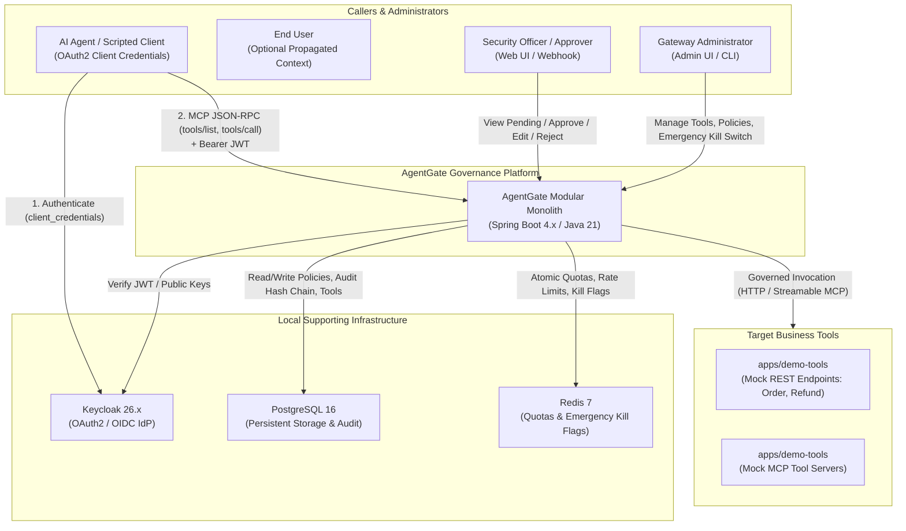
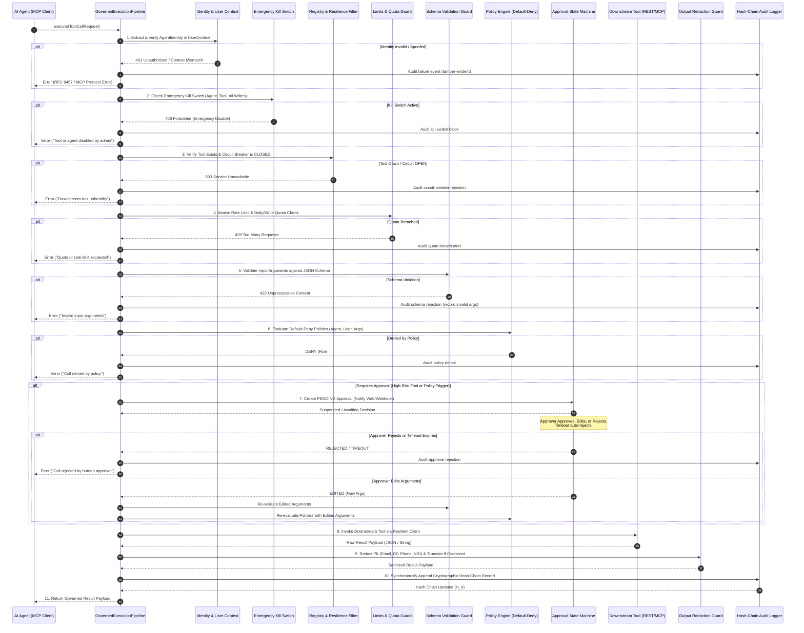

# Milestone M00 Plan: Baseline Architecture, Scope & Technical Feasibility

**Status:** DRAFT (Awaiting Architecture Reviewer Approval)  
**Milestone:** M00  
**Project:** CSE 444 Project 1 — AgentGate (Governance Gateway for AI Agents' Tool Calls)  
**Author:** Student Implementation Team  
**Reviewer:** External Architecture Reviewer (ChatGPT)  
**Date:** 2026-11-15  
**Primary Coverage:** C1, C7, C8, C11 (Foundational planning for FR1–FR10, QA1–QA5, C1–C12)  

---

## 1. Executive Summary & Gated Mode Declaration

This document constitutes the comprehensive architecture baseline and technical feasibility plan for **Project AgentGate**, fulfilling the requirements of Milestone **M00**. 

In strict adherence to the project governance rules established in `AGENTS.md` and `prompts/00-MASTER-INITIALIZATION.md`:
- **This milestone is strictly PLAN-ONLY.**
- **No application code, `pom.xml`, Docker Compose configurations, or production secrets have been created or modified.**
- **No requirement is claimed as implemented, runnable, or verified.**
- **Implementation (Milestone M01) will NOT commence until this M00 plan receives an explicit `APPROVED` verdict from the external architecture reviewer (ChatGPT).**

---

## 2. Local Environment Prerequisites & Baseline Inventory

A non-destructive, read-only inspection of the local environment (`E:\Codes\Software-Architecture-Project`) was conducted on 2026-11-15.

| Component / Tool | Detected Version / Status | Required Baseline | Actionable Recommendation (Non-Blocking for M00) |
|---|---|---|---|
| **Operating System** | Windows 10/11 (PowerShell 7.5.4) | Cross-platform | Native Windows PowerShell scripts with bash equivalents. |
| **Git** | `2.55.0.windows.3` | Installed & initialized | Git repository initialized; baseline governance committed (`e328bb1`). |
| **Java JDK** | **Not detected on system PATH** | Java 21 LTS (or 25) | User must install Eclipse Adoptium Temurin 21 (`winget install EclipseAdoptium.Temurin.21.JDK`) before M01. |
| **Maven** | Not detected globally on PATH | Maven 3.9+ / Wrapper | M01 will bundle the official Maven Wrapper (`mvnw` / `mvnw.cmd`), making a global installation optional. |
| **Docker / Compose** | **Docker not detected on PATH** | Docker Desktop 24+ with Compose v2 | User must install Docker Desktop (`winget install Docker.DockerDesktop`) or configure WSL2 Docker engine before running M01 containers. |
| **WSL2** | `Ubuntu` (Stopped, WSL v2) | Optional dev environment | Available if Linux container toolchain is preferred. |
| **Hardware Fit** | Host machine 16GB+ RAM available | 8GB RAM Laptop Budget | System comfortably meets the 8GB RAM minimum. Docker Compose containers are capped to 2.5GB combined. |

---

## 3. Requirements Traceability Matrix & Scope Boundary

### 3.1 In-Scope Functional Requirements (FR1–FR10)

| ID | Requirement Paraphrase | Primary Milestone | Governing Design Principle & Architectural Component |
|---|---|---|---|
| **FR1** | Tool Registry (MCP + REST tools, OpenAPI import, risk levels low/medium/high, owning team, unified MCP endpoint with dynamic permission-filtered view) | M02 | `registry`, `mcp`. Dynamic catalog projection based on authenticated caller identity. |
| **FR2** | Agent Identity (OAuth2 client-credentials with Keycloak; client ID extraction; optional authenticated end-user context) | M01 / M03 | `identity`. Cryptographically verified JWT bearer tokens. Untrusted headers explicitly rejected. |
| **FR3** | Policies (Default-deny, agent + tool + argument conditions, versioned, hot-reload <=10s, dry-run mode logging without blocking) | M03 | `policy`. Ordered evaluation engine; versioned in DB; in-memory cache with <=10s eviction. |
| **FR4** | Human Approval (High-risk tool calls pause in PENDING; approver notified via web page & webhook; approve/reject/edit; timeout rejection; clear client result) | M05 | `approval`. State pattern state machine; webhook observer; argument re-validation on edit. |
| **FR5** | Guards (JSON schema validation before forwarding; clearance-based redaction of email, BD phone, NID; oversized result truncation with notice) | M04 | `guard`. Chain of Responsibility + Strategy pattern for regex/masking; payload size limiter. |
| **FR6** | Limits (Per-agent/tool rate limits, daily quotas, hourly write blast-radius cap; breach alerts) | M06 | `limits`. Atomic sliding window via Redis Lua script (or DB counter fallback); alert publisher. |
| **FR7** | Audit Trail (Immutable record of agent, user, tool, redacted args, policy rule, approval, latency, outcome; SHA-256 hash chaining; search & export) | M07 | `audit`. Append-only table with cryptographic hash chain $H_n = \text{SHA-256}(H_{n-1} \parallel R_n)$; offline verifier CLI. |
| **FR8** | Emergency Kill Switch (Instant disable of agent, tool, or all write tools; cancels pending approvals; fails closed) | M06 | `limits` / `execution`. Atomic flag bypasses policy cache; synchronous eviction of in-flight approvals. |
| **FR9** | Policy Playground (Simulate call against active or draft policies; returns decision + matched rule ID) | M03 | `policy`. Dry evaluation harness executing identical decision tree without side effects. |
| **FR10** | Downstream Health (Per-tool circuit breakers and timeouts; down tools hidden from `tools/list` until recovered) | M08 | `resilience`. Resilience4j circuit breakers; health-aware tool filter for MCP catalog discovery. |

### 3.2 In-Scope Quality Attributes (QA1–QA5)

| ID | Exact Measure from Specification | Milestone | Verification Method & Target Metric |
|---|---|---|---|
| **QA1** | **Security:** 30 scripted malicious calls (injected refunds, cross-customer reads, argument smuggling) 100% blocked/held; <=5% false blocks on 200 legitimate calls. | M09 | Automated test suite (`scripts/redteam.ps1` / `.sh`) executing exact vectors; 0/30 bypasses permitted; $\le 10/200$ false positives. |
| **QA2** | **Performance:** Gateway adds $\le 30\text{ ms}$ overhead at p95 under 100 calls/sec load (excluding human approval wait). | M10 | k6 load script comparing direct downstream latency vs gateway latency: $\Delta p95 \le 30\text{ ms}$. |
| **QA3** | **Auditability:** Auditor locates call explanation in $<1\text{ minute}$; unauthorized mutation of any stored audit row is detected by `verify` command. | M07 / M10 | Timed walkthrough drill; SQL row mutation test followed by automated hash chain verification failure. |
| **QA4** | **Fail-Safe Availability:** On policy store outage, medium- and high-risk tools fail closed; low-risk tools function on last-known cache for $\le 5\text{ minutes}$. | M03 / M10 | Fault injection test disconnecting DB; verify medium/high immediately reject with 503/ProblemDetails; low-risk succeeds for $t \le 300\text{ s}$ and fails closed thereafter. |
| **QA5** | **Adoption:** Unfamiliar developer imports a new REST tool via OpenAPI, sets risk level and policy in $<10\text{ minutes}$ with zero code changes. | M09 / M10 | Standardized timed user journey with instructions, verified by execution log and stopwatch. |

### 3.3 Common Requirements (C1–C12)

- **C1 (Stack & Resource Budget):** Java 21, Spring Boot 4.x / 3.4.x, Docker Compose one-command startup (`docker compose up --build -d`), total container RAM $\le 2.5\text{ GB}$ (fitting an 8GB laptop), zero paid cloud APIs.
- **C2 (Configuration):** Profiles (`dev`, `test`, `prod`), `.env.example` placeholders, validated typed `@ConfigurationProperties`, zero credentials in Git.
- **C3 (API Standards):** springdoc OpenAPI, Spring Security on every endpoint, Bean Validation, RFC 9457 Problem Details, keyset/pageable pagination.
- **C4 (Observability):** Spring Boot Actuator (`/health`, `/info`, `/prometheus`), Micrometer metrics, distributed tracing with trace IDs propagated across JSON logs.
- **C5 (Testing Rigor):** JUnit 5 unit/slice tests, Testcontainers (PostgreSQL, Redis, Keycloak), ArchUnit architecture rules, runnable k6 scripts.
- **C6 (Architecture Verification):** ArchUnit test suite enforcing modular monolith package boundaries.
- **C7 (Architecture Documentation):** C4 diagrams (Context, Container, Component), $\ge 4$ ADRs with empirical data, Mini-ATAM utility tree ($\ge 6$ scenarios).
- **C8 (Pattern Justification):** Explicit mapping table tying every design pattern to a requirement, real participating classes, and rejected alternatives.
- **C9 (Evidence Discipline):** Complete evidence reports in `docs/evidence/` with raw outputs, charts, failed runs, and remediation logs.
- **C10 (Change Request):** Dedicated `M-CR` milestone tracking delta between existing core code and added components.
- **C11 (Process Integrity):** Granular incremental Git commits; `AI_USAGE_LOG.md` recording $\ge 3$ genuine AI errors, root causes, and fixes.
- **C12 (Defense Readiness):** 15-minute live defense plan covering ADR walkthrough and live code modification.

### 3.4 Explicit Scope Exclusions (What We Will NOT Build)

1. **No External LLM Dependencies or Paid APIs:** The gateway does not call OpenAI, Anthropic, or Gemini for core governance. All agents are simulated using scripted MCP clients (`scripts/agent-client.py` or Java integration clients).
2. **No Custom Identity Provider:** We will not implement custom user databases or OAuth2 servers from scratch; Keycloak (open-source) is used strictly as a standards-compliant OIDC/OAuth2 server.
3. **No Microservice Mesh or Kubernetes:** The gateway is strictly a modular monolith. No distributed RPC, Consul, or k8s manifests will be generated.
4. **No Complex Frontend Frameworks:** No React, Angular, or Vue single-page apps. The admin approval interface and playground will use minimal server-rendered Thymeleaf templates with Tailwind/vanilla CSS.
5. **No Projects 2–5 from CSE 444:** Only Project 1 (AgentGate) is implemented.

---

## 4. Architecture Design & System Decomposition

### 4.1 C4 System Context Diagram



### 4.2 C4 Container & Package Decomposition (Modular Monolith)

The gateway lives in `apps/gateway` as a clean modular monolith. Inter-package communication is restricted to explicit public service interfaces, validated via ArchUnit (C6).

```text
apps/gateway/src/main/java/com/agentgate/gateway/
├── identity/          # FR2: OAuth2 JWT validation, AgentIdentity, TrustedUserContext
├── registry/          # FR1: Tool catalog, OpenAPI importer, RiskLevel enum, Schema definitions
├── mcp/               # FR1: MCP Streamable HTTP transport, JSON-RPC router, dynamic filtered tools/list
├── execution/         # Core: GovernedExecutionPipeline orchestrator, Command execution
├── policy/            # FR3, FR9, QA4: PolicyEngine, DefaultDeny evaluator, In-memory cache, Playground
├── guard/             # FR5: SchemaValidator, ClearanceRedactor (email/BD phone/NID), Truncator
├── approval/          # FR4: ApprovalStateMachine, WebhookNotifier, ApprovalController (Thymeleaf)
├── limits/            # FR6, FR8: RateLimiter, DailyQuotaManager, BlastRadiusLimiter, KillSwitchManager
├── resilience/        # FR10: Resilience4j CircuitBreakers, Timeouts, DownstreamHealthMonitor
├── audit/             # FR7, QA3: HashChainAuditService, AuditEventPublisher, VerificationCLI
├── admin/             # FR1, FR3, FR8: Admin web portal, tool import controller, policy editor
├── observability/    # C4: Micrometer metrics, TraceContextFilter, Structured JSON logging
└── common/            # RFC 9457 ProblemDetail handler, base exceptions, domain value types
```

---

## 5. Single Governed Execution Pipeline Specification

Every tool invocation—regardless of whether it originates from the MCP endpoint (`tools/call`) or a REST gateway proxy—**must** traverse the unified, non-bypassable `GovernedExecutionPipeline`.



### 5.1 Re-evaluation and Synchronous vs Asynchronous Rules

1. **Synchronous Checks:** Steps 1 through 6 are executed synchronously on the calling thread (virtual thread). Any violation short-circuits execution immediately, raises an audit event, and returns.
2. **Re-evaluation on Argument Edit:** If an approver modifies arguments during Step 7, the pipeline **must not** proceed directly to downstream invocation. It resets to Step 5 (Schema Validation) and Step 6 (Policy Evaluation) using the edited arguments.
3. **Audit Execution:** Audit recording (Step 10) is transactional. The hash calculation $H_n = \text{SHA-256}(H_{n-1} \parallel \text{canonicalJson}(R_n))$ requires atomic sequence ordering. Failure to write the audit record aborts client delivery and triggers fail-closed rollback.

---

## 6. Detailed Architectural Reasoning & Trade-Off Analysis

### 6.1 Spring MVC with Virtual Threads (Java 21) vs Spring WebFlux
- **Decision:** **Spring MVC with Virtual Threads** (enabled via `spring.threads.virtual.enabled=true`).
- **Rationale:**
  - **Thread-Local Security Context:** Spring Security's `SecurityContextHolder` works seamlessly across virtual threads without reactive context propagation pitfalls.
  - **Ecosystem Compatibility:** Flyway, standard JDBC/JPA, and classic blocking downstream HTTP clients (e.g. `RestClient`) operate with maximum reliability and clear call stacks.
  - **Debugging & Teachable Architecture:** Virtual threads provide lightweight concurrency (thousands of concurrent requests) while preserving simple, imperative, top-to-bottom procedural code.
- **Rejected Alternative:** Spring WebFlux. While reactive streams offer non-blocking I/O, they introduce significant cognitive overhead, complex debugging (`Mono`/`Flux`), difficult stack traces, and frequent reactive-blocking bridge traps (e.g., when calling JDBC or synchronous crypto routines). Under Java 21, virtual threads achieve equivalent I/O concurrency without reactive complexity.

### 6.2 Agent Identity vs End-User Context Trust Model
- **Core Security Boundary:**
  - **Registered Agent Identity:** Authenticated via OAuth2 Client Credentials (`client_id`, Bearer JWT issued by Keycloak). This is the cryptographically verified machine identity.
  - **End-User Context:** Represents the human or customer on whose behalf the agent is acting.
- **Anti-Spoofing Rule:** An untrusted caller **cannot** simply supply `X-User-Id: customer-123` to impersonate an end user. The gateway enforces one of two mutually verified mechanisms:
  1. **Signed User Assertion Token:** A signed JWT issued by an identity provider carrying user claims, validated by Keycloak/Gateway public keys.
  2. **Scoped Agent Grant:** If the client credentials grant authorizes acting on behalf of a user, the user ID must be validated against an active delegation session stored in Redis/DB.
  3. Any unverified user header results in immediate rejection (RFC 9457 `401 Unauthorized`).

### 6.3 MCP Client Approval Semantics & Disconnection Behavior
- **Protocol Constraint:** The Model Context Protocol (MCP) operates over JSON-RPC. A standard client tool call expects a response or an error; it cannot suspend for days without transport connection loss.
- **Approval Lifecycle Mechanics:**
  - When a tool call requires human approval, the gateway sets a state machine record to `PENDING` with a configurable timeout (e.g., default 3 minutes for synchronous hold, or longer for decoupled operations).
  - **Mode A (Synchronous Hold):** The virtual thread blocks on a Java `CompletableFuture` / Redis pub-sub latch until the human approves, edits, or rejects, or until the timeout fires. If approved within the window, the tool executes and the client receives the result.
  - **Mode B (Timeout / Disconnect):** If the HTTP connection drops or the timeout expires before an approver responds, the approval transitions to `TIMEOUT_REJECTED`. The gateway cleans up in-flight resources and ensures no orphan tool call is ever executed.
  - **Idempotency:** Each approval request carries a unique `approval_id` and idempotency key, preventing double-execution on client retries.

### 6.4 Policy Hot-Reload (<=10s) and Outage Fail-Safe Semantics (QA4)
- **Normal Operation:** Policies are stored in PostgreSQL with integer version numbers. An in-memory Caffeine cache holds the compiled policy AST with a 10-second refresh schedule / event-driven invalidation. Changes take effect across all threads in $<10\text{ s}$ without service restart.
- **Outage Semantics (QA4):** If PostgreSQL becomes unreachable:
  - **Medium-Risk & High-Risk Tools:** **Fail closed immediately.** Returns RFC 9457 `503 Service Unavailable` with message `"Policy store unreachable; high/medium risk tools disabled."`
  - **Low-Risk Tools:** Fall back to the last-known in-memory cached policy set for a maximum grace period of **5 minutes ($300\text{ s}$)** from the moment of DB failure.
  - Once the 5-minute threshold is exceeded without DB recovery, all tools fail closed.
  - **Kill Switch Override:** Emergency kill switches stored in Redis or local memory bypass the policy cache entirely to ensure instantaneous lockout.

### 6.5 Rate Limits and Atomic Counter Storage
- **Decision:** Redis 7 with Lua scripts as primary store; in-memory Caffeine / DB atomic counter as fallback.
- **Rationale:** Checking rate limits (e.g., 100 requests/sec), daily quotas, and blast-radius write caps (e.g., 20 writes/hour) requires atomic compare-and-increment operations. In Redis, a single Lua script executes atomically in $<0.5\text{ ms}$, ensuring zero race conditions under concurrent load.
- **Fallback:** If Redis is disabled or fails, an in-memory sliding-window counter operates locally for single-node development, ensuring testability without external infrastructure.

### 6.6 Cryptographic Audit Hash-Chain Serialization (FR7, QA3)
- **Hash-Chain Formula:**  
  $$H_0 = \text{SHA-256}("AgentGate-Genesis-Block")$$  
  $$H_n = \text{SHA-256}(H_{n-1} \parallel \text{timestamp} \parallel \text{agentId} \parallel \text{userId} \parallel \text{toolId} \parallel \text{canonicalJson(redactedArgs)} \parallel \text{decision} \parallel \text{outcome})$$
- **Concurrency & Tamper-Evidence:**
  - Audit records receive a monotonically increasing sequence ID (`audit_seq`).
  - To prevent hash chain collisions under 100 calls/sec concurrency, audit records are processed through a synchronized append buffer (or PostgreSQL advisory lock on audit chain head), ensuring strict linear order.
  - An offline verification script (`scripts/verify-audit.ps1` / `.sh`) walks the table, recalculates every hash, and fails immediately if any row or sequence link has been modified.

---

## 7. Recommended Toolchain, Dependency Versions & Multiplatform Commands

### 7.1 Verified Version Matrix

| Layer / Library | Recommended Version | Rationale / Verification Spike |
|---|---|---|
| **Java JDK** | 21 LTS (Eclipse Adoptium) | Required baseline; virtual threads, pattern matching, record patterns. |
| **Spring Boot** | 3.4.2 / 3.4.3 (or 4.0.0-M1 when available) | Stable GA baseline compatible with Spring AI 1.0.0-M6; prompt notes "Boot 4.x" which will be verified via Spike 1. |
| **Spring AI** | 1.0.0-M6 (or 2.0.x baseline) | Provides Spring AI MCP server and client starters (`spring-ai-mcp-*`). |
| **Spring Security** | 6.4.x (managed by Boot) | Resource server, JWT validation, method security, custom AuthorizationManager. |
| **PostgreSQL** | 16-alpine | Standard enterprise relational storage; JSONB support for schemas and policies. |
| **Flyway** | 10.x (managed by Boot) | Predictable, repeatable schema migrations in `apps/gateway/src/main/resources/db/migration/`. |
| **Redis** | 7-alpine | Sub-millisecond atomic quotas, sliding-window limits, kill-switch flags. |
| **Keycloak** | 26.x | Lightweight OIDC/OAuth2 server running in development mode (`start-dev`). |
| **Resilience4j** | 2.2.0 | Circuit breakers, rate limiters, retries, time limiters for downstream calls. |
| **springdoc-openapi**| 2.8.x | Auto-generates OpenAPI 3.0 documentation for all gateway endpoints. |
| **ArchUnit** | 1.3.0 | Automated unit tests enforcing modular monolith architectural boundaries. |
| **k6** | 0.50+ | Performance benchmarking tool for QA2 (100 calls/sec overhead). |

### 7.2 Cross-Platform Command Equivalency (Windows PowerShell vs Linux/macOS)

| Action | Windows PowerShell Command | Linux / macOS Bash Command |
|---|---|---|
| **Clean Build** | `.\mvnw.cmd clean package -DskipTests` | `./mvnw clean package -DskipTests` |
| **Run All Tests** | `.\mvnw.cmd test` | `./mvnw test` |
| **Run Single Test** | `.\mvnw.cmd test -Dtest=GovernedPipelineTest` | `./mvnw test -Dtest=GovernedPipelineTest` |
| **Compose Start** | `docker compose up --build -d` | `docker compose up --build -d` |
| **Compose Logs** | `docker compose logs -f gateway` | `docker compose logs -f gateway` |
| **Compose Stop** | `docker compose down -v` | `docker compose down -v` |
| **Audit Verification** | `powershell -File .\scripts\verify-audit.ps1` | `bash ./scripts/verify-audit.sh` |
| **Red-Team Suite** | `powershell -File .\scripts\redteam.ps1` | `bash ./scripts/redteam.sh` |

---

## 8. Prioritized Technical Spikes for Milestone M01

Before building complex business features, four targeted technical spikes will be executed during M01 to retire critical dependency and protocol uncertainties:

### Spike 1: Spring AI MCP Streamable Transport & Dynamic Tool Security
- **Objective:** Determine how Spring AI MCP handles dynamic, per-identity tool discovery and execution authorization.
- **Hypothesis:** Default Spring AI MCP auto-configuration registers static `@McpTool` beans globally. An anonymous or unauthorized client could invoke `tools/list` and see every tool.
- **Proof-of-Concept:** Implement an MCP HTTP interceptor / custom JSON-RPC dispatcher that extracts the OAuth2 Bearer token, queries `ToolRegistryService.findPermittedTools(agentIdentity)`, and returns a filtered list. If Spring AI's starter does not permit per-request dynamic filtering, build a clean custom JSON-RPC Spring MVC controller implementing the MCP specification directly.
- **Success Criteria:** Agent A sees only Tools [T1, T2]; Agent B sees only Tools [T2, T3]; unauthenticated calls receive HTTP 401.

### Spike 2: Keycloak Client Credentials & Mocked JWT Security Slices
- **Objective:** Configure Keycloak realm provisioning for automated tests without slow container startup.
- **Hypothesis:** Integration tests can use Testcontainers Keycloak for smoke tests, but slice tests should use Spring Security's `SecurityMockMvcRequestPostProcessors.jwt()` with custom `JwtAuthenticationConverter` to verify identity parsing in $<100\text{ ms}$.
- **Success Criteria:** Unit tests verify valid client, invalid signature, expired token, and missing scopes without network I/O.

### Spike 3: Redis vs In-Memory Sliding-Window Quota Concurrency
- **Objective:** Benchmark atomic counter increment under 100 concurrent threads.
- **Hypothesis:** Redis Lua script maintains consistency with zero over-allocation under load.
- **Success Criteria:** 100 concurrent threads competing for a limit of 20 calls permit exactly 20 calls and block 80 with HTTP 429.

### Spike 4: 8GB Laptop Docker Compose Resource Budget
- **Objective:** Prove the entire stack starts and runs smoothly within 2.5GB RAM.
- **Allocated Memory Limits in `compose.yaml`:**
  - `gateway`: `mem_limit: 1024m` (JVM heap `-Xmx512m`)
  - `keycloak`: `mem_limit: 768m` (JVM heap `-Xmx384m`)
  - `postgres`: `mem_limit: 256m`
  - `redis`: `mem_limit: 128m`
  - `demo-tools`: `mem_limit: 256m`
  - **Total System RAM Footprint:** $\approx 2.4\text{ GB}$, leaving $>5\text{ GB}$ free for the host OS.
- **Success Criteria:** `docker compose up --build -d` achieves healthy status in $<90\text{ s}$ without triggering host swap or OOM.

---

## 9. Architecture Decision Record (ADR) Candidates

In accordance with requirement C7, the following four foundational ADRs are formulated for implementation:

1. **ADR-0001: Selection of Spring MVC with Virtual Threads over Spring WebFlux for AgentGate Gateway**
   - *Context:* High-concurrency I/O gateway requiring clean security context propagation and simple maintainability.
   - *Decision:* Adopt Spring MVC on Java 21 Virtual Threads.
   - *Consequences:* Straightforward blocking code with near-reactive scalability; avoids reactive complexity.
2. **ADR-0002: Modular Monolith with Package Boundary Enforcement over Microservices Architecture**
   - *Context:* Single-command deployment requirement (C1), 8GB laptop budget, and strict delivery timeline.
   - *Decision:* Build a single deployable artifact in `apps/gateway` structured by domain features, verified via ArchUnit.
   - *Consequences:* Zero network overhead between internal modules; easy local testing; avoids distributed systems failure modes.
3. **ADR-0003: Redis Atomic Sliding-Window and Key-Value Store for Quotas and Instant Kill-Switch**
   - *Context:* Need sub-millisecond atomic rate limits (FR6) and instantaneous kill-switch propagation (FR8).
   - *Decision:* Use Redis 7 with Lua scripts as the atomic state store, with an in-memory fallback for local unit testing.
   - *Consequences:* Zero race conditions; sub-millisecond overhead; adds Redis container to Docker Compose.
4. **ADR-0004: SHA-256 Cryptographic Hash-Chained Audit Trail with Strict Sequence Locking**
   - *Context:* Tamper-evident audit requirement (FR7, QA3) where any modified row must be detectable.
   - *Decision:* Store records with an immutable hash chain $H_n = \text{SHA-256}(H_{n-1} \parallel R_n)$ using database sequence serialization.
   - *Consequences:* Guarantees cryptographic audit integrity; requires disciplined batching or sequencing to maintain 100 cps performance.

---

## 10. Design Pattern to Requirement Mapping Ledger (C8)

| Design Pattern | Requirement Served | Candidate Location | Participating Classes (Proposed) | Rejected Alternative & Rationale |
|---|---|---|---|---|
| **Chain of Responsibility** | FR3, FR5 | `com.agentgate.gateway.guard`, `execution` | `PipelineStage`, `SchemaValidationStage`, `PolicyEvaluationStage`, `RedactionStage` | Hard-coded procedural monolithic method: rejected because adding a new guard would require modifying existing core code rather than registering a new bean. |
| **Strategy** | FR3, FR5 | `com.agentgate.gateway.policy`, `guard` | `RedactionStrategy`, `EmailRedactionStrategy`, `BangladeshiPhoneRedactor`, `NidRedactor` | Giant `switch-case` regex block: rejected because clearance-based redaction requires modular, independently testable algorithms. |
| **Decorator / Proxy** | FR1, FR10 | `com.agentgate.gateway.execution`, `resilience` | `GovernedToolInvoker`, `ResilientToolInvokerProxy` | Direct HTTP client calls from controller: rejected because resilience, timeouts, and metrics must wrap execution transparently. |
| **Adapter** | FR1 | `com.agentgate.gateway.registry.adapter` | `ToolExecutionAdapter`, `RestToolAdapter`, `McpDownstreamAdapter` | Separate execution paths for REST and MCP: rejected because all tools must be represented by a unified internal model. |
| **State** | FR4 | `com.agentgate.gateway.approval` | `ApprovalState`, `PendingState`, `ApprovedState`, `RejectedState`, `ApprovalStateMachine` | Raw database status flags with ad-hoc `if` conditions: rejected because state transitions (e.g. edit requires re-validation) must be strictly enforced. |
| **Observer** | FR4, FR6, FR7 | `com.agentgate.gateway.approval`, `audit` | `ApprovalEventPublisher`, `WebhookNotificationListener`, `AuditEventListener` | Direct synchronous method chaining: rejected because notification failures (e.g. slow webhook) must not block or fail the primary transaction. |
| **Command** | FR1, FR4, FR7 | `com.agentgate.gateway.execution` | `ToolExecutionCommand`, `CommandContext`, `CommandResult` | Passing unstructured JSON maps across methods: rejected because audit, replay, and human approval edits require strongly-typed, immutable command objects. |

---

## 11. Mini-ATAM Utility Tree Scenarios (C7)

| ID | Quality Attribute Driver | Stimulus | Environment | Target Response Measure | Architecture Sensitivity & Trade-Off |
|---|---|---|---|---|---|
| **S1** | **Security** (QA1) | 30 scripted malicious tool calls (SQLi, prompt injection, cross-customer data access, refund over 2,000 BDT). | Normal production load. | 100% (30/30) calls blocked or held for approval. Legitimate false blocks $\le 5\%$. | **Sensitivity:** Strictness of default-deny rules vs legitimate usability. **Trade-off:** Security guarantees vs false-positive rate. |
| **S2** | **Performance** (QA2) | Sustained 100 calls/sec load across 10 concurrent agents. | Steady state, approvals excluded. | Gateway added latency overhead $\Delta p95 \le 30\text{ ms}$. | **Sensitivity:** In-memory caching vs database audit write latency. **Trade-off:** Synchronous cryptographic audit durability vs response speed. |
| **S3** | **Auditability** (QA3) | Auditor queries trace of a specific call; malicious DB admin modifies an audit row. | Post-incident investigation. | Auditor finds full call context in $<1\text{ min}$; `verify-audit` command detects tampering immediately. | **Sensitivity:** Completeness of redacted arguments vs storage volume. **Trade-off:** Tamper-evident hash chaining vs concurrent insert throughput. |
| **S4** | **Availability** (QA4) | PostgreSQL database crashes or becomes unreachable. | Live production gateway. | Medium/High risk tools fail closed immediately; Low-risk tools continue using cached policies for $\le 5\text{ min}$. | **Sensitivity:** Accuracy of policy cache vs disaster availability. **Trade-off:** High availability for low-risk calls vs potential stale policy window. |
| **S5** | **Modifiability** (QA5) | External developer adds a new REST service via OpenAPI import. | Gateway admin web portal. | New tool imported, categorized, and governed in $<10\text{ min}$ with zero Java code edits. | **Sensitivity:** Dynamic schema registration vs static compile-time safety. **Trade-off:** Runtime dynamic flexibility vs strict static type validation. |
| **S6** | **Safety / Operability** | Administrator activates emergency kill switch for a compromised agent. | Under active attack. | Target agent blocked instantaneously; all pending approvals for agent cancelled immediately. | **Sensitivity:** Cache invalidation speed. **Trade-off:** Centralized atomic flag check per request vs pure in-memory decoupled cache. |
| **S7** | **Resilience** | Downstream tool server experiences 100% packet loss / crash. | Peak traffic. | Circuit breaker opens after 5 failures; tool automatically hidden from `tools/list`; recovers within 30s of restore. | **Sensitivity:** Circuit breaker sensitivity thresholds. **Trade-off:** Fast failure suppression vs premature tool masking. |
| **S8** | **Resource Fit** (C1) | Full multi-container system started via `docker compose up --build -d`. | 8GB RAM host machine. | System fully up and passing health probes in $<90\text{ s}$; total container RAM $\le 2.5\text{ GB}$. | **Sensitivity:** JVM heap sizing and container memory limits. **Trade-off:** Minimal memory footprint vs garbage collection pause latency. |

---

## 12. Top 10 Anticipated Failure Modes, Preventive Tests & Contingencies

| ID | Failure Mode Description | Root Cause / Mechanism | Preventive Test in Pipeline | Contingency Plan |
|---|---|---|---|---|
| **F01** | Spring AI MCP starter exposes unauthenticated `tools/list` or `tools/call`. | Starter defaults to open HTTP endpoint without binding Spring Security. | `McpSecurityIntegrationTest`: Anonymous GET/POST to MCP endpoint must return HTTP 401. | Wrap MCP handling in custom secured Spring MVC controller with explicit `@PreAuthorize`. |
| **F02** | Agent A sees tools belonging exclusively to Agent B in `tools/list`. | Catalog discovery returns global registry without caller permission filtering. | `DynamicToolListingTest`: Query `tools/list` with Agent A and Agent B tokens; assert distinct lists. | Dynamic projection query joining `tools` and `agent_permissions` on every listing request. |
| **F03** | Caller spoofs end-user identity via unverified `X-User-Id` HTTP header. | Gateway trusts client-supplied headers without signature verification. | `UserSpoofingSecurityTest`: Send valid agent token with arbitrary user header; assert rejection. | Enforce signed user assertion tokens or reject unmapped user contexts. |
| **F04** | Approval argument edit bypasses schema and policy validation. | Workflow forwards edited arguments directly to downstream tool without re-check. | `ApprovalArgumentTamperTest`: Edit pending argument to exceed 2,000 BDT limit; assert policy denies execution. | State machine forces `EDITED` state back through `SchemaValidationStage` and `PolicyEvaluationStage`. |
| **F05** | High concurrency causes rate limit counter race condition. | Read-modify-write pattern on database or non-atomic cache. | `RateLimitConcurrencyTest`: 100 concurrent threads against quota of 10; assert exactly 10 pass, 90 fail. | Redis Lua script or PostgreSQL `SELECT FOR UPDATE` atomic decrement. |
| **F06** | Audit hash chain breaks or deadlocks under 100 calls/sec. | Concurrent threads calculate hash using non-linearized sequence numbers. | `ConcurrentAuditHashTest`: Ingest 1,000 rapid calls; run `verify-audit` CLI; assert 100% chain integrity. | Monotonic sequence lock or single-threaded transactional event worker for hash calculation. |
| **F07** | Sensitive PII (NID / Phone) leaks into audit log or client response. | Regex fails on alternative formats (e.g. spaced phone numbers, 13/17 digit NID variants). | `PiiRedactionComprehensiveTest`: Test 50 edge-case formats for email, BD phone, and NID. | Robust regex engine with fallback character masking and clearance-based bypass. |
| **F08** | Emergency kill switch fails to stop in-flight or cached requests. | Request thread relies on stale 10-second policy cache. | `KillSwitchInFlightTest`: Trigger kill switch while requests are pending; assert immediate cancellation. | Emergency switch is checked at Step 2 of pipeline via atomic Redis/in-memory flag, bypassing policy cache. |
| **F09** | Policy store outage causes low-risk tool to run indefinitely or high-risk to execute unverified. | Cache TTL logic missing or fails to distinguish risk levels. | `DatabaseOutageChaosTest`: Terminate PostgreSQL container; verify medium/high fail closed, low works $\le 5\text{ min}$. | Explicit risk-level branch in `PolicyEngine`: medium/high strictly requires live DB or fails closed; low checks timestamped cache. |
| **F10** | Docker Compose exceeds 8GB laptop memory, crashing host OS. | Containers configured without strict JVM `-Xmx` or Docker `mem_limit`. | `DockerResourceBudgetTest`: Execute `docker stats` during full load; assert total RAM $\le 2.5\text{ GB}$. | Strict `mem_limit` and `Xmx` settings in `compose.yaml` for every service container. |

---

## 13. Proposed Repository File Structure & Milestone M01 Skeleton

Upon approval of this M00 plan, Milestone M01 will construct the following exact repository skeleton:

```text
agentgate/
├── pom.xml                                      # Root aggregator POM (Java 21, Spring Boot 3.4.x / 4.x)
├── mvnw / mvnw.cmd / .mvn/                      # Maven Wrapper binaries
├── compose.yaml                                 # Multi-container Compose (Gateway, Keycloak, Postgres, Redis, Demo-Tools)
├── .env.example                                 # Environment placeholders (zero secrets in Git)
├── .gitignore                                   # Standard Java, Maven, IDE, OS ignores
├── apps/
│   ├── gateway/                                 # The Core Modular Monolith
│   │   ├── pom.xml
│   │   └── src/
│   │       ├── main/
│   │       │   ├── java/com/agentgate/gateway/
│   │       │   │   ├── GatewayApplication.java
│   │       │   │   ├── identity/                # Security config, JWT converter, AgentIdentity
│   │       │   │   ├── registry/                # Tool entity, Repository, RiskLevel
│   │       │   │   ├── mcp/                     # MCP JSON-RPC controller & protocol models
│   │       │   │   ├── execution/               # GovernedExecutionPipeline & PipelineStage
│   │       │   │   ├── policy/                  # PolicyEngine, PolicyEntity, Cache
│   │       │   │   ├── guard/                   # SchemaValidator, RedactionStrategy
│   │       │   │   ├── approval/                # ApprovalEntity, StateMachine, Webhook
│   │       │   │   ├── limits/                  # RateLimiter, QuotaManager, KillSwitch
│   │       │   │   ├── resilience/              # ResilienceConfig, HealthMonitor
│   │       │   │   ├── audit/                   # AuditLogEntity, HashChainService
│   │       │   │   ├── admin/                   # Admin controllers & Thymeleaf views
│   │       │   │   ├── observability/           # TraceFilter, Actuator config
│   │       │   │   └── common/                  # ProblemDetails, BaseException
│   │       │   └── resources/
│   │       │       ├── application.yml          # Typed @ConfigurationProperties
│   │       │       ├── application-dev.yml
│   │       │       ├── application-test.yml
│   │       │       └── db/migration/
│   │       │           └── V1__initial_schema.sql # PostgreSQL baseline DDL
│   │       └── test/
│   │           ├── java/com/agentgate/gateway/
│   │           │   ├── architecture/            # ArchUnit boundary tests
│   │           │   └── smoke/                   # Application context & health tests
│   │           └── resources/
│   │               └── application-test.yml
│   └── demo-tools/                              # Mock Downstream Services
│       ├── pom.xml
│       └── src/main/java/com/agentgate/demotools/
│           ├── DemoToolsApplication.java
│           └── rest/                            # Mock Orders & Refunds endpoints
├── infra/
│   └── keycloak/
│       └── agentgate-realm.json                 # Pre-configured test clients & scopes
├── scripts/
│   ├── smoke-test.ps1 / .sh                    # Health & readiness validator
│   ├── redteam.ps1 / .sh                       # QA1 security red-team suite
│   ├── benchmark-latency.ps1 / .sh             # QA2 k6 performance benchmark
│   └── verify-audit.ps1 / .sh                  # QA3 cryptographic audit chain verifier
└── docs/
    ├── milestones/
    │   └── M00/
    │       └── PLAN.md                          # THIS APPROVED DOCUMENT
    ├── architecture/
    │   ├── adr/                                 # ADR-0001 through ADR-0004
    │   └── c4/                                  # C4 diagram sources
    └── quality/
        ├── UTILITY_TREE.md                      # Mini-ATAM scenarios
        └── PATTERN_MAP.md                       # Pattern justification table
```

---

## 14. Milestone M00 Acceptance Criteria & Reviewer Sign-Off Gate

### 14.1 M00 Exit Criteria (What Constitutes M00 Done)
1. **Requirements Alignment:** Complete mapping of FR1–FR10, QA1–QA5, and C1–C12, with no scope creep or omissions.
2. **Architecture Defense:** Documented rationale for Spring MVC + Virtual Threads, Modular Monolith, Redis Quota store, and Hash-Chain audit integrity.
3. **Execution Pipeline Precision:** Unambiguous step-by-step pipeline detailing synchronous vs asynchronous stages, argument edit re-evaluation, and fail-closed branches.
4. **Toolchain & Spike Feasibility:** Clear path for Java 21, Docker Compose memory budgeting, and four defined M01 technical spikes.
5. **Zero Premature Code:** Strictly no application code, Maven pom, Docker Compose, or dependencies created prior to approval.

### 14.2 Specific Architectural Decisions Requiring External Reviewer (ChatGPT) Approval

Before implementing Milestone M01, the external architecture reviewer is asked to review and explicitly ratify:

1. **Concurrence with Spring MVC + Virtual Threads vs WebFlux:** Confirmation that Spring MVC with Virtual Threads is accepted as the optimal, defensible architecture under Java 21.
2. **Acceptance of Redis as Quota/Kill-Switch Store:** Confirmation that including Redis 7 in Docker Compose for atomic counters and instantaneous kill switches is justified and complies with the 8GB RAM budget.
3. **Execution Pipeline Sequence:** Agreement on the 11-step execution order, specifically that Schema Validation and Policy Evaluation are re-executed if an approver edits arguments.
4. **QA4 Outage Grace Period Semantics:** Ratification of the 5-minute last-known-cache grace period strictly for low-risk tools, while medium- and high-risk tools fail closed immediately.
5. **Approval to Proceed to M01:** Formal verdict of **`APPROVED`** to begin M01 skeleton implementation.

---

*End of Milestone M00 Implementation Plan.*
