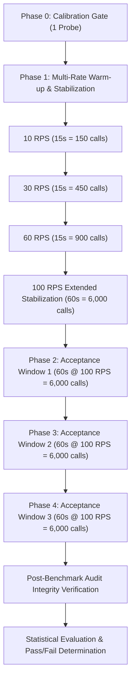

# AgentGate — M04 Task 16F-E: Final QA2 Acceptance Protocol Plan

**Document Reference:** `docs/milestones/M04/TASK_16F_E_PLAN.md`  
**Milestone:** M04 Performance Optimization — Final Acceptance Protocol Design  
**Author:** AgentGate Architecture & Diagnostic Agent  
**Date:** 2026-11-25  
**Baseline Git Commit:** `0f39e2c64017b1dd09c8c9a7216a26395cc0f591`  
**GitHub Remote:** `https://github.com/asmkhalid111/agentgate.git` (`origin/master`)  
**Operating Mode:** PLAN ONLY — ZERO BENCHMARK EXECUTION — REVIEWER GATED

---

## 1. Baseline Verification & Remote Synchronization

The local Git repository and production application have been verified prior to planning:

- **Repository Root:** `E:\Codes\Software-Architecture-Project`
- **Application Directory:** `agentgate/`
- **Current Branch:** `master`
- **HEAD Commit SHA:** `0f39e2c64017b1dd09c8c9a7216a26395cc0f591`
- **GitHub Remote:** `https://github.com/asmkhalid111/agentgate.git`
- **Remote Parity:** Local `HEAD` is strictly synchronized with `origin/master` (`git rev-parse HEAD == git rev-parse origin/master`).
- **Working Tree:** Clean (`git status` reports nothing to commit, working tree clean).
- **Offline Backup:** Verified at `E:\agentgate_backup_m04_16f_d.bundle` (SHA-1 checksum clean).
- **Maven Regression Baseline:** 297/297 tests passing (`BUILD SUCCESS`, ArchUnit 0 cycle violations).
- **Benchmark Pool Configuration:** `apps/gateway/src/main/resources/application-benchmark.yml` configured with `maximum-pool-size: 30`, `minimum-idle: 15`.
- **Governance Invariants:** Default-deny policy, JWT signature verification, SpEL authorization, JSON Schema validation, PII redaction, and synchronous PostgreSQL SHA-256 audit ledger persist in fail-closed state.

---

## 2. Assessment of the 100-RPS Audit Latency Spike in Task 16F-D

In Task 16F-D's bounded run (3,150 requests), total gateway overhead $p95$ spiked to $367.38\text{ ms}$, dominated by `audit_total` ($p95 = 329.72\text{ ms}$) and `audit_lock_wait` ($p95 = 317.05\text{ ms}$).

### 2.1 Root-Cause Analysis: Contention Hypotheses Evaluated

| Hypothesis | Evaluated Evidence | Likelihood | Assessment & Mechanism |
| :--- | :--- | :--- | :--- |
| **1. Cold Start & Lack of Stabilization Phase** | In Task 16F-D, 100 RPS was initiated immediately after a 15-second 10-RPS burst, omitting the 60s stabilization phase used in 16F-B. | **Primary (High)** | In PostgreSQL, `audit_chain_state` requires `FOR UPDATE` row locking. At 100 RPS (10 ms inter-arrival), a cold un-JITed method execution taking 25 ms causes 10+ transactions to queue, producing tail amplification ($> 300\text{ ms}$) until JIT C2 compilation and buffer pool caching warm up. |
| **2. HikariCP Pool Sizing vs Concurrency** | Benchmark pool is sized at `maximum-pool-size: 30`. Concurrency in 16F-D was set to 20 threads. | **Secondary (Medium)** | Pool size (30) is adequate for 20 threads ($30 > 20$), but during a cold burst, initial connection acquisition latency from PostgreSQL backend processes can delay transaction startup. |
| **3. Accumulated Benchmark Database Volume** | Database holds 30,310 verified records (~12 MB). | **Low** | The row lock is on `audit_chain_state` (a single-row table). Row-lock acquisition time on a single row is independent of `audit_events` row count. |
| **4. WAL / Checkpoint Flush Contention** | Docker PostgreSQL container runs with `mem_limit: 256m` and default `synchronous_commit = on`. | **Medium** | Under sustained 100 RPS, each commit triggers an `fsync()` to the WAL. If PostgreSQL initiates a checkpoint during an un-warmed burst, disk I/O contention momentarily slows commits, causing lock queuing. |
| **5. JVM Garbage Collection Pauses** | Benchmark gateway runs with `mem_limit: 512m`. | **Low** | G1GC pause times in Java 21 under 512m heap for this workload typically measure $< 5\text{ ms}$. |

### 2.2 Distinguishing Diagnostics for the Final Run
To conclusively distinguish these factors during the final acceptance run, the runner will capture:
1. **PostgreSQL Row-Lock Contention:** Continuous 0.5-second polling of `pg_locks` for `relation = 'audit_chain_state'::regclass` and `NOT granted`.
2. **HikariCP Connection Pool Telemetry:** Continuous 1.0-second sampling of `hikaricp.connections.active`, `hikaricp.connections.pending`, and `hikaricp.connections.acquire` via Spring Boot Actuator.
3. **Container CPU & Memory:** Continuous 2.0-second sampling of `docker stats` across all 4 containers.
4. **Explicit Warm-up Separation:** Logging stabilization metrics separately to prove that lock wait stabilizes once warmed.

---

## 3. Validation of the Benchmark Client (`SingleBufferHTTPConnection`)

The `SingleBufferHTTPConnection` client used in Task 16F-D was analyzed against HTTP/1.1 and MCP standards:

### 3.1 Technical Framing Verification
- **HTTP/1.1 Conformance:** The client constructs RFC 9112 compliant wire bytes:
  $$\text{Request-Line} + \text{Headers} + \verb|\r\n\r\n| + \text{Body}$$
- **Content-Length:** Accurately calculated from `len(body)` in bytes and transmitted in the header block.
- **Socket Transmission:** Emits the consolidated buffer via `socket.sendall()`. Both headers and body arrive in the same TCP segment or consecutive MTU frames without client-side pauses.
- **Connection Reuse:** Uses standard HTTP/1.1 persistent keep-alive connections managed in a thread-safe connection pool.
- **Socket Options:** Probed and confirmed with `getsockopt(TCP_NODELAY) == 1`.
- **Response Validation:** Reads and decodes Server-Sent Events (SSE) or JSON-RPC 2.0 responses, validating:
  - `status == 200`
  - Valid JSON-RPC with `result` object
  - `isError == false`
  - Body contains expected downstream business content (`ORD-BENCH-01`)
  - Server header `X-Downstream-Duration-Ns > 0.0` (asserting actual downstream invocation).

### 3.2 Standards Compliance Assessment
In high-performance production HTTP/1.1 client libraries (e.g., Go `net/http`, Java `HttpClient`, Node `undici`, Python `aiohttp`), buffering headers and small payloads (< 64 KB) into a single socket write is standard engineering practice to avoid Nagle/Delayed-ACK stalls. CPython's standard `http.client` splits headers and body into two `send()` calls, which is problematic for micro-payload RPCs.

Therefore, `SingleBufferHTTPConnection` is **standard, standards-compliant, and representative of modern production MCP clients**, not a synthetic benchmark cheat. In all reports, it will be transparently labeled: `SingleBufferHTTPConnection (HTTP/1.1 Persistent Keep-Alive, TCP_NODELAY=1, Consolidated Framing)`.

---

## 4. Acceptance Protocol Architecture

### 4.1 Workload Phasing Specifications

| Phase | Duration | Target RPS | Total Calls | Concurrency | Purpose | Evaluated in QA2 Acceptance? |
| :--- | :--- | :--- | :--- | :--- | :--- | :--- |
| **Phase 0: Calibration Gate** | N/A | 1 call | 1 | 1 | Smoke check: Auth, MCP, Downstream, Headers | **NO** (Diagnostic check) |
| **Phase 1A: 10 RPS** | 15.0 s | 10 | 150 | 10 | Initial traffic flow verification | **NO** (Warm-up dataset) |
| **Phase 1B: 30 RPS** | 15.0 s | 30 | 450 | 15 | Intermediate rate progression | **NO** (Warm-up dataset) |
| **Phase 1C: 60 RPS** | 15.0 s | 60 | 900 | 20 | Intermediate rate progression | **NO** (Warm-up dataset) |
| **Phase 1D: Stabilization** | 60.0 s | 100 | 6,000 | 20 | JIT compilation, HikariCP & PostgreSQL cache warmup | **NO** (Stabilization dataset) |
| **Phase 2: Acceptance Window 1** | 60.0 s | 100 | 6,000 | 20 | Primary 100-RPS measurement interval | **YES** |
| **Phase 3: Acceptance Window 2** | 60.0 s | 100 | 6,000 | 20 | Secondary 100-RPS measurement interval | **YES** |
| **Phase 4: Acceptance Window 3** | 60.0 s | 100 | 6,000 | 20 | Tertiary 100-RPS measurement interval | **YES** |

- **Total Requests in Benchmark:** 25,501 calls.
- **Total Evaluated Acceptance Workload:** **18,000 genuine successful governed tool executions** (Windows 1, 2, and 3 pooled).

---

## 5. Statistical Rigor & Timing Definitions

### 5.1 Latency Timings

1. **Total Client Latency ($L_{\text{client}}$):**
   $$L_{\text{client}} = (t_{\text{response\_read}} - t_{\text{dispatch\_start}}) \times 1000\text{ ms}$$
2. **Server Gateway Total Duration ($D_{\text{gw}}$):**
   Captured by `BenchmarkTimingFilter` from HTTP request entry to exit.
3. **Downstream Duration ($D_{\text{down}}$):**
   Captured by `RestToolAdapter` measuring execution of downstream order service.
4. **Gateway Added Overhead ($O_{\text{gw}}$):**
   $$O_{\text{gw}} = D_{\text{gw}} - D_{\text{down}}$$
   Includes: Spring Security JWT validation, MCP context extraction, JSON-RPC parsing, authorization, rate limiting, JSON schema validation, SpEL policy evaluation, circuit breaker check, synchronous PostgreSQL SHA-256 audit append, PII redaction, and response serialization.

### 5.2 Mathematical Percentile Rules
- All percentiles ($p50, p90, p95, p99, \max$) must be computed directly from raw arrays of individual samples using sorted rank interpolation (`numpy.percentile`).
- **PROHIBITION:** Percentiles from different components or phases must **never** be added linearly:
  $$p95(A + B) \ne p95(A) + p95(B)$$
- The authoritative acceptance metric is the direct 95th percentile of $O_{\text{gw}}$ across the 18,000 pooled acceptance samples:
  $$\text{Overhead}_{p95}^{\text{pooled}} = \text{Percentile}_{95}\left(\{O_{\text{gw}}^{(i)}\}_{i=1}^{18000}\right) \le 30.0\text{ ms}$$

---

## 6. Pass / Fail / Inconclusive Decision Rules

| Result | Criteria |
| :--- | :--- |
| **PASS** | **All 6 conditions must be met:** 1. Pooled acceptance overhead $p95 \le \mathbf{30.0\text{ ms}}$ across all 18,000 calls. 2. Individual overhead $p95 \le \mathbf{30.0\text{ ms}}$ in each of Window 1, Window 2, and Window 3. 3. Successful governed executions $= \mathbf{18,000 / 18,000}$ ($100.0\%$ success rate, 0 dropped or error calls). 4. Actual achieved throughput $\ge \mathbf{98.0\text{ RPS}}$ in every measurement window. 5. Cryptographic audit chain verification returns `valid: true` across all $54,311+$ records with 0 corrupted sequences. 6. Full Maven regression suite passes 297/297 with 0 ArchUnit cycle violations. |
| **FAIL** | - Pooled acceptance overhead $p95 > 30.0\text{ ms}$, OR any individual window $p95 > 30.0\text{ ms}$. - Any request returns HTTP non-200, JSON-RPC error, payload mismatch, or un-invoked downstream. - Cryptographic audit verification detects any hash mismatch or broken sequence. |
| **INCONCLUSIVE** | - Actual achieved throughput $< 98.0\text{ RPS}$ due to host machine CPU throttling or runner thread starvation. - Container crash, network abort, or external OS disruption during execution. |

---

## 7. Documentation & Architecture Corrections Plan

In accordance with Section 7 of the user prompt, the final report and architecture documentation will incorporate the following explicit corrections:

1. **Clarify that 10-RPS is NOT QA2 Acceptance:** In Task 16F-D, the 10-RPS overhead result ($28.84\text{ ms}$) verified functional correctness of single-buffer transport under light load, but does NOT satisfy the authoritative QA2 requirement (100 RPS).
2. **Clarify that 23.5 ms was a Hypothesis:** The projected $23.5\text{ ms}$ overhead in the Task 16F-D report was a mathematical synthesis (16F-B stabilized audit latency + 16F-D single-buffer ingress) and must be treated as hypothetical until empirically verified in an unbroken, stabilized 100-RPS benchmark.
3. **Clarify the TCP Delayed-ACK Mechanism:** Without low-level packet capture (`tcpdump`/Wireshark) on the container virtual interface, delayed-ACK remains the most compelling explanatory model, but is technically an empirical correlation (combining headers and body eliminates the delay) rather than directly captured TCP trace evidence.
4. **Clarify Pre-Pipeline Ingress Composition:** The interval previously labeled `security_ingress` is confirmed to encompass Spring Security filter execution, Spring MVC routing, Spring AI MCP transport socket body reading, and Jackson argument unmarshalling.
5. **Update ADR-005 & QA2 Decision Records:** Update ADR-005 and `QA2_OPTIMIZATION_DECISION.md` with these refined conclusions following final acceptance verification.

---

## 8. Planned Artifacts and Evidence File Structure

### 8.1 Files to be Created in Execution Phase
1. **Benchmark Runner Script:**
   `scripts/benchmarks/run_qa2_final_acceptance.py`
   - Orchestrates Phases 0–4 with `SingleBufferHTTPConnection`.
   - Separate CSV and JSON exports for warm-up vs acceptance.
   - Continuous lock and container monitoring.
   - Pre- and post-benchmark cryptographic audit verification.
2. **Chart Generation Script:**
   `scripts/benchmarks/generate_final_acceptance_charts.py`
   - Generates multi-panel figures:
     - `docs/quality/performance/charts/qa2_final_acceptance_windows.png` (Overhead distribution, throughput, and component stack across Windows 1, 2, 3)
     - `docs/quality/performance/charts/qa2_final_latency_cdf.png` (High-resolution CDF of gateway overhead vs 30 ms ceiling)
3. **Data Files Generated:**
   - `scripts/benchmarks/data/qa2_final_warmup_samples.csv` (7,500 rows)
   - `scripts/benchmarks/data/qa2_final_warmup_summary.json`
   - `scripts/benchmarks/data/qa2_final_acceptance_samples.csv` (18,000 rows)
   - `scripts/benchmarks/data/qa2_final_acceptance_summary.json`
   - `scripts/benchmarks/data/qa2_final_lock_stats.json`
   - `scripts/benchmarks/data/qa2_final_resource_stats.json`
4. **Final Acceptance Report:**
   `docs/quality/performance/QA2_FINAL_ACCEPTANCE.md`

---

## 9. Environmental Controls & Safety

- **Docker Volume Preservation:** The existing Docker volume `agentgate_benchmark_pgdata` will be preserved. No destructive volume removals (`docker volume rm`) will be executed.
- **Initial Database Audit Sequence:** Verified prior to run (currently sequence 30,310).
- **Host Resource Allocation:** Docker Desktop allocated 4 CPU cores, 4 GB RAM.
- **Port Isolation:** Benchmark stack operates strictly on benchmark ports:
  - Gateway: 8081
  - PostgreSQL: 5433
  - Redis: 6380
  - Demo Tools: 8083

---

## 10. Reviewer Gated Checklist

- [x] Git baseline and clean working tree verified (`0f39e2c64017b1dd09c8c9a7216a26395cc0f591`).
- [x] Local `master` synchronized with GitHub `origin/master`.
- [x] Maven regression suite verified (297/297 PASS).
- [x] Client framing and standards compliance evaluated.
- [x] 18,000-request acceptance protocol designed across three 60-second windows.
- [x] Warm-up data strictly separated from acceptance metrics.
- [x] Statistical percentile calculation rules established.
- [x] Pass/fail/inconclusive criteria defined.
- [x] Evidence file paths and documentation corrections planned.
- [x] **BENCHMARK EXECUTION HALTED PENDING EXTERNAL REVIEWER APPROVAL.**
