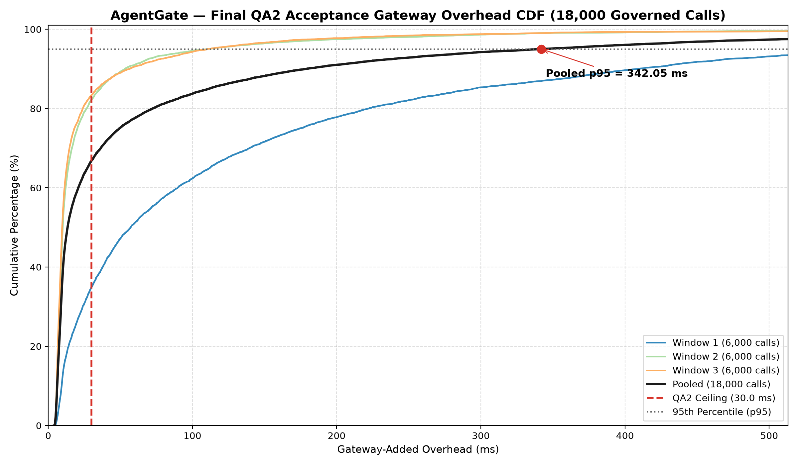
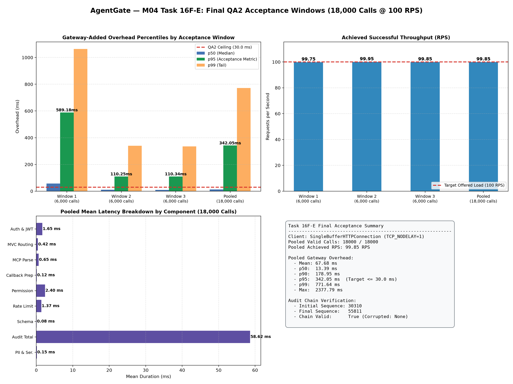

# AgentGate quality evidence report

This report consolidates the recorded evidence for QA1–QA5 through the C5 checkpoint. The runs use different revisions and environments. Each source records the conditions for its own result.

| Attribute | Handout measure | Observed result | Status |
|---|---|---|---|
| QA1 Security | Block or hold all 30 malicious calls and falsely block at most 5% of 200 legitimate calls | 38/38 malicious calls blocked or held. 0/200 legitimate calls falsely blocked. | Recorded pass |
| QA2 Performance | Gateway overhead at most 30 ms p95 at 100 calls/sec, excluding approval waits | Original run had 18,000 valid calls at 99.85/s and 342.05 ms p95. A later k6 run offered 100/s, completed 17,172 calls, dropped 829 iterations, and measured 429.77 ms p95. | Failed |
| QA3 Auditability | Explain a call in under 60 seconds and detect a stored row edit | Authenticated known-term lookup of two delegated decisions took 0.332 seconds. Three isolated checks detected edited content, middle deletion and tail deletion. | Passed in local walkthrough and isolated tests |
| QA4 Fail-safe availability | Deny medium/high risk during an outage and allow matching low-risk requests from cache for at most five minutes | Under injected policy-repository failure, medium/high risk never reached the adapter. Matching low risk passed at 299 seconds and was blocked at 300 and 301 seconds. All 16 audit records verified. | Passed for injected policy-repository failure |
| QA5 Adoption | A developer unfamiliar with AgentGate adds a REST tool in under ten minutes without code changes | Automated rehearsal completed in 8.40 seconds on the local stack. The independent developer trial has no recorded result yet. | Pending independent trial |

## Raw outputs and reproduction

| Attribute | Evidence and commands |
|---|---|
| QA1 | [Recorded per-case results](../../scripts/data/qa1_security_results.json), [vectors](../../scripts/data/qa1_test_vectors.json), [runner](../../scripts/verify_qa1_security.py), [report and confusion matrix](../milestones/M04/QA1_SECURITY_REPORT.md) |
| QA2 | [Original request samples](../../scripts/benchmarks/data/qa2_final_acceptance_samples.csv), [summary](../../scripts/benchmarks/data/qa2_final_acceptance_summary.json), [k6 metrics](../milestones/M07/QA2_K6_METRICS.json), [k6 entry point](../../scripts/run_qa2_ci.py) |
| QA3 | [Observed audit rows and tamper command](QA3_AUDITABILITY.md), [live delegation and timed lookup runner](../../scripts/verify_delegated_orders.py) |
| QA4 | [Scenario outputs and reproduction](QA4_POLICY_STORE_OUTAGE_VERIFICATION.md), [outage integration test](../../apps/gateway/src/test/java/com/agentgate/gateway/policy/PolicyStoreOutageIntegrationTest.java) |
| QA5 | [Independent trial instructions and observer record](../adoption/QA5_WALKTHROUGH.md), [automated rehearsal](../../scripts/verify_qa5_onboarding.py), [recorded rehearsal timing](../milestones/M07/COMPLETION.md) |

## QA2 charts

The first chart shows the distribution of per-call gateway overhead. The second shows how tail latency varied between windows. Both belong to the original run. The later k6 run has separate throughput and latency figures in its exported metrics.

## Failed runs and response

- The original performance investigation traced an ingress delay to TCP behavior in the benchmark client. The team changed it to send each request in one buffer. The subsequent 18,000-call run still missed QA2. Its audit chain lock wait measured 314.22 ms p95, which now informs the audit architecture decision. [Transport experiment](performance/QA2_TRANSPORT_EXPERIMENT.md) · [Original acceptance](performance/QA2_FINAL_ACCEPTANCE.md)
- The bounded pool and resource experiment still missed the latency target. The later k6 attempt exhausted local resources. Its rerun capped workers at 48, retained the offered rate and thresholds, and exported the failed result including drops. [Optimization experiment](performance/QA2_16FG_FINAL_OPTIMIZATION.md) · [k6 run and recovery](../milestones/M07/COMPLETION.md)
- The first C3/C4 baseline had Redis unavailable. Starting the existing Redis service yielded 300 passing tests at the same revision. The first live JSON logs had no trace IDs. Adding the Brave runtime bridge yielded matching gateway and downstream trace IDs for both protocols. [C3/C4 checkpoint](../milestones/M05/COMPLETION.md)
- The C5 run exposed a timeout assertion that relied on exception text. The test now checks typed causes as well. Testcontainers runs in the Maven integration phase, and the final local verification passed 307 tests. [C5 checkpoint](../milestones/M07/COMPLETION.md)
